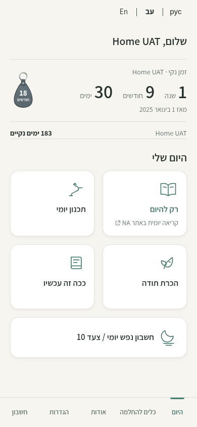
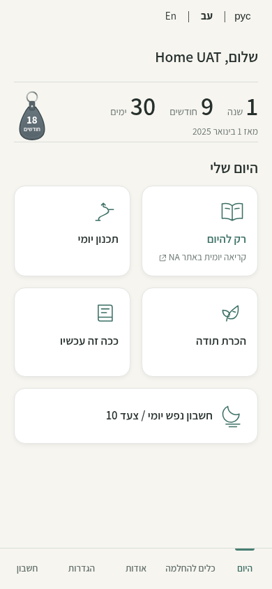
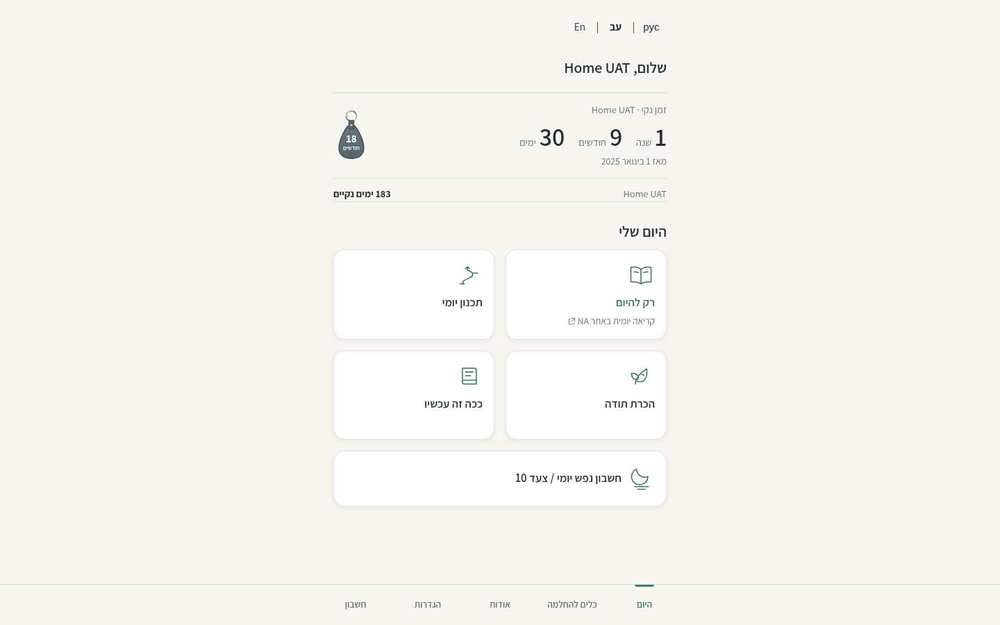
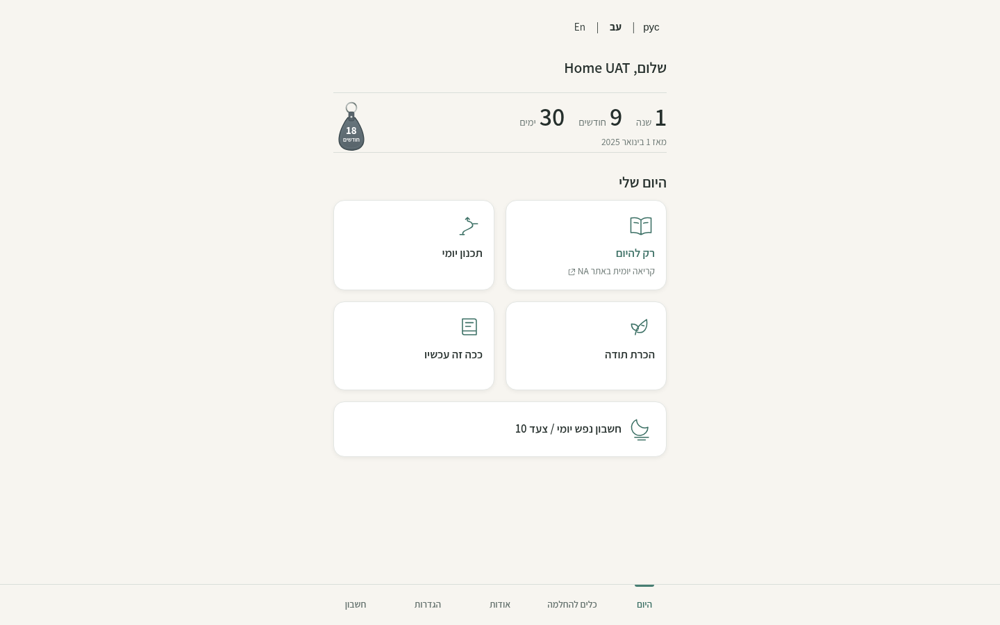

# Signed-in Home summary — issue #69

The personalized greeting remains at the top of signed-in Home. The entire primary label line and secondary-counter row are removed from the signed-in layout, including their margins, so the name appears once and the daily cards move up. The primary calendar duration, recovery date, milestone badge and existing 2×2 + full-width Step 10 cards are unchanged. The recovery summary keeps a localized accessible group label.

This is presentation-only. Guest Home keeps its existing recovery labels and optional secondary summary. Existing secondary visibility and counter-mode preferences remain untouched. All recovery paths, dates and presentation modes remain available through Settings → Counters and views; no state fields are deleted, migrated or saved by this change. The layout refreshes when account/sync status resolves, as well as when the counter refreshes.

## Screenshots

Same synthetic account name is deliberately used for the greeting and both recovery labels to reproduce the original three-name case. No real account or recovery content is used. The account has verified, locally generated encrypted test data and a mocked backend. Fresh browser contexts use version-matched local service workers. Before is production merge `c818247`; after is this branch. Viewports and dates match: 390×844 / 1440×900, 31 October 2026, Europe/Amsterdam.

| View | Before | After |
| --- | --- | --- |
| Mobile |  |  |
| Desktop |  |  |

[English at 320px](home-account-reference/after-en-320.png) · [Russian at 320px](home-account-reference/after-ru-320.png) · [Dark Home](home-account-reference/after-dark-mobile.png) · [Preserved counter details](home-account-reference/counter-details.png)

## Verification

444 browser assertions passed across seven targeted suites:

- New signed-in summary regression: 53 checks, using a repeated-name synthetic registered account with verified encrypted backup. Hebrew/English/Russian at 320/360/390/1440px; full rows occupy zero height, the name appears once, summary height stays compact, first action is visible, and counter/date/badge/five cards remain. All three counter presentations, secondary selection, direct daily links, reload and exact recovery-byte preservation are checked.
- Existing guest Home/card/keyboard matrix: 193 checks, including both themes and enlarged text.
- Existing navigation: 47; i18n/encrypted journeys: 64; active registered-user upgrade: 57; real offline/service-worker behavior: 20; CSP/security headers: 10.

Repository hygiene, seven publication/hygiene tests, JavaScript syntax, CSP hashes, Preview build and whitespace checks passed before publishing. Hosted Preview remains guest-only under the established deployment isolation; signed-in captures and tests use local synthetic fixtures. The screenshots are review documentation and stay outside the deployment allowlist.

Deliver as a Draft PR with Preview for owner review. No automatic merge or Production deployment.
