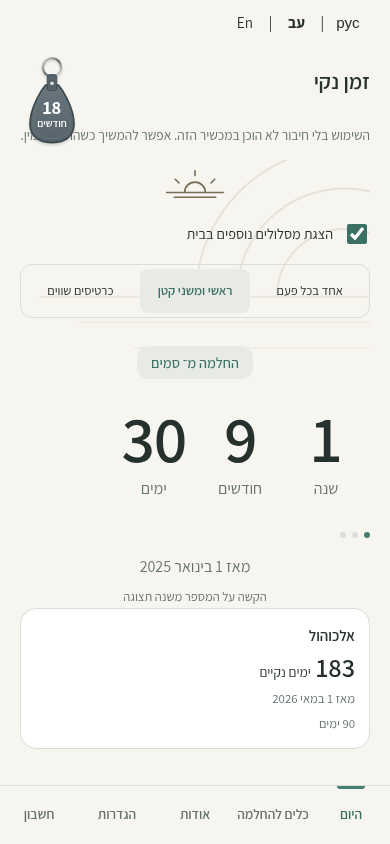
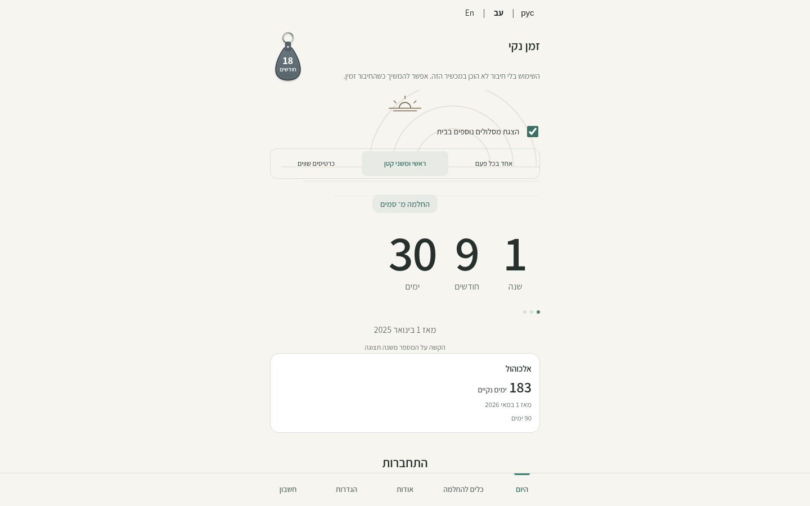

# Guided daily Home — owner review

Home now puts a compact recovery summary above the five directly accessible daily activities: רק להיום, תכנון יומי, הכרת תודה, ככה זה עכשיו, חשבון נפש יומי. The reading uses the existing external NA Israel URL. Its secondary line identifies the external reading and, in English/Russian, its Hebrew language. Nothing tracks completion or requires an activity to be finished before another can open.

## Deliberate discoverability changes

- The primary summary always describes the primary recovery path, regardless of the counter selected in details. Its start date and calendar duration stay visible.
- A secondary recovery path is a small row. Additional paths remain available in details. Existing device visibility preferences are respected. New defaults show a compact secondary path; the existing optional second-path setup checkbox defaults on and can still be unchecked.
- “כל המונים והתצוגות” opens one optional counter detail view, keeping Today active in the existing footer. It contains the existing single/compact/equal-card presentations, path selector, and tappable numerical counter with all three formats. Browser Back/Forward and an explicit “חזרה להיום” button return to Home.
- The “show additional paths on Home” checkbox moves to details. Hiding the secondary summary does not hide saved paths or presentation options in details.
- Recovery-date/path editing stays in Settings, reached directly from details. The shared footer retains Today, Tools, About, Settings and Account. No new intermediate page is required to start a daily activity.
- The existing key-tag milestone is smaller and refers to the primary Home path. Its existing Settings visibility preference is retained. Large decorative Home artwork is removed; the existing font, palette, RTL/LTR behavior, appearance settings and component conventions remain.

No dependency, recovery-data format, schema, sync/auth or analytics changes are introduced. Counter display preferences remain device-local. Existing unknown/legacy recovery fields remain intact. Step 10 content and implementation remain separate in [issue #16](https://github.com/onahum2023/clean-time/issues/16); no new questions ship here.

## Before and after

These are public review images with synthetic dates and no account data, captured at 390×844 and 1440×900. The actual implementation images include the existing local/Preview backup-unavailable notice. This can push the fifth action below the first viewport at smaller heights; normal scrolling still reaches every action and the primary status and first action remain visible. No status notices were hidden for the screenshots. The source fixtures use 31 October 2026 in Europe/Amsterdam.

| View | Before | After |
| --- | --- | --- |
| Mobile |  |  |
| Desktop |  |  |

[English at 360px](home-ux-reference/after-en-360.png) · [Russian at 360px](home-ux-reference/after-ru-360.png)

These documentation images are excluded from the existing deployment allowlist.

## Validation

- Home acceptance suite: 90 assertions covering default secondary visibility, disclosure, every numerical/presentation mode, keyboard activation and heading focus, Back/Forward, primary identity, preference persistence, recovery-history/timestamp preservation and 200% text. Layout matrix: Hebrew/English/Russian, light/dark, 360/390/1440px. In the synthetic local configuration without a backup warning, all five actions fit above the footer at 360×800.
- Existing navigation (47), timer (25), milestone (52), welcome (180), language/encrypted journeys (64), setup/display (48), local feature journeys (82), active-user upgrade (57), real offline/service-worker (20), security-header (10), account (27), recovery-flow (29) and analytics (149) checks passed.
- Total: 880 browser assertions across 14 suites, plus 7 repository-hygiene/publication tests. Inline JS and message syntax, CSP regeneration, Preview build and diff whitespace checks passed.
- Independent agent QA: 19 navigation/history/keyboard/byte-preservation assertions, plus Home and all detail modes at 320/360/390/1280px in three languages. Found and verified the CSS specificity fix for 36px summary numerals; no remaining blocking findings.

All account/sync checks use synthetic identities and mocked backend traffic. No production user data or backend configuration was used. The hosted Preview remains guest-only under the repository's existing build isolation. A live registered-account UAT and owner UX review remain release checks before merge.

## Review and release

Deliver as a Draft PR and Vercel Preview. Independent QA was requested and completed locally. Keep the PR draft pending owner UX review and release checks. Do not merge or deploy to production automatically.
