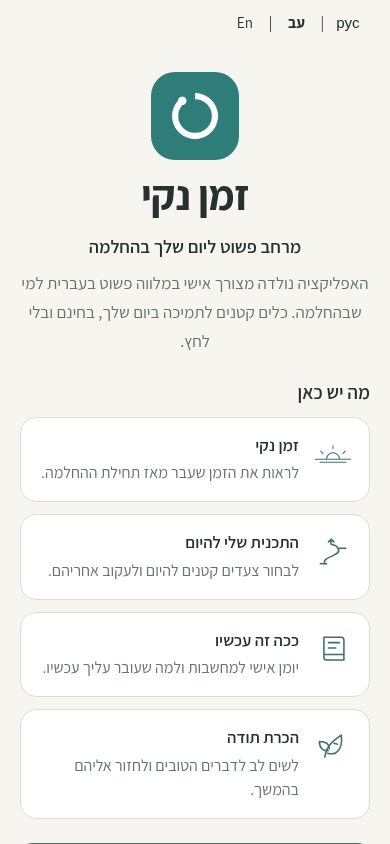
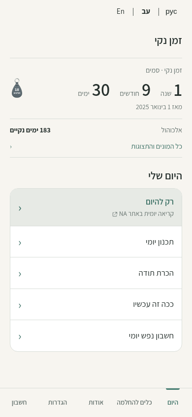
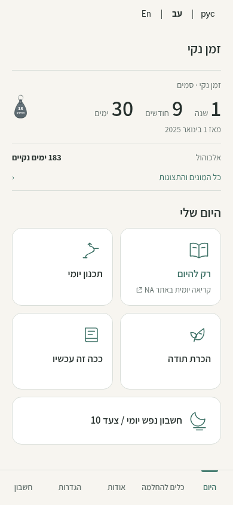
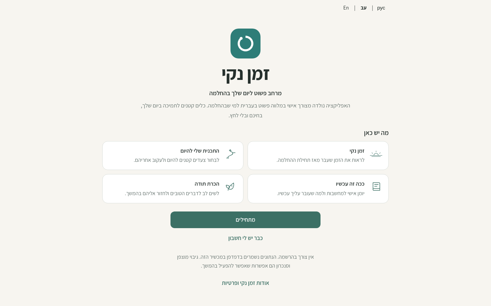
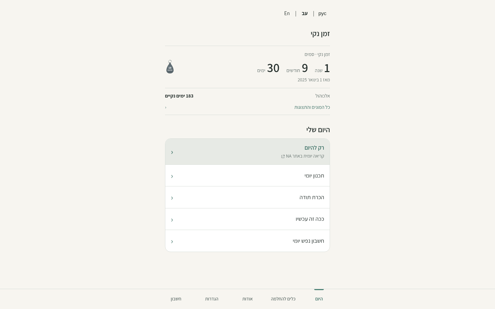
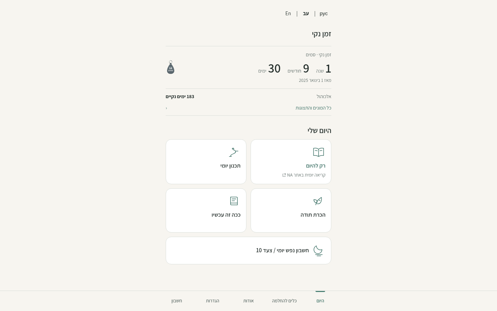

# Guided daily Home — revised owner review

Home shows a compact recovery summary followed by four daily cards in a 2×2 grid and one full-width Step 10 card. This revision addresses the [owner's PR #68 feedback](https://github.com/onahum2023/clean-time/pull/68#pullrequestreview-5723184892).

## Daily card layout

The DOM, keyboard and reading order is fixed: רק להיום, תכנון יומי, הכרת תודה, ככה זה עכשיו, חשבון נפש יומי / צעד 10. In Hebrew RTL, reading/plan occupy the top right/left, and gratitude/journal the bottom right/left. English and Russian follow the same sequence in LTR. Step 10 spans both columns immediately beneath the four cards, using the same surface, border and corner treatment.

Home and Welcome share the card surface, subtle border, 16px corners, title typography, accent icon styling and 12px spacing rules. Home reuses the established reading, plan, gratitude, journal and inventory illustrations. The first action has an accent title and a short external-reading description; its safe external URL and separate-window behavior are preserved. Native buttons and links retain the shared visible focus outline; Home adds restrained hover/pressed states. Welcome's existing content and responsive composition are unchanged.

The grid stays two columns at 320/360/390px and desktop widths. At 320px, 10px padding and 0.95rem titles keep long Russian labels legible without clipping. Card height can grow with text. At enlarged font sizes or with status notices, the page scrolls normally; the footer does not prevent reaching the fifth card. No completion tracking, forced sequence, wizard or score is introduced.

## Preserved discoverability and functionality

- The compact primary summary always describes the primary path, independent of the counter selected in details. Its start date and calendar duration stay visible.
- A secondary path is a small row; every saved path remains in details. Stored device visibility preferences are respected. New defaults show a compact secondary path; the existing optional second-path setup choice can still be unchecked.
- “כל המונים והתצוגות” opens the optional counter view, keeping Today active in the footer. All three numerical formats, the single/compact/equal-card presentations, path selector and Home visibility checkbox remain accessible. Browser Back/Forward and “חזרה להיום” work.
- Recovery-date/path editing stays in Settings. The existing footer retains Today, Tools, About, Settings and Account. Every daily card opens its destination directly.
- The small primary-path key-tag milestone and its Settings visibility preference remain. The existing palette, Assistant font, appearance settings, Hebrew RTL and English/Russian LTR remain.

No dependency, recovery-data format, schema, authentication, sync or analytics change is introduced by the card revision. Existing guest/offline tools, encrypted backup and unknown/legacy data fields are preserved. Step 10 content stays separate under [issue #16](https://github.com/onahum2023/clean-time/issues/16); no new questions ship here.

## Matched Welcome / signed-in Home evidence

Each comparison uses the same viewport: mobile 390×844 or desktop 1440×900. Welcome is the unchanged reference. “Previous Home” is commit `7cdb9a4`, the list layout rejected in owner review. “Revised Home” is the 2×2 + 1 card implementation. The same synthetic recovery dates and registered account are used for both Home versions, with an actually generated encrypted test envelope and a mocked backend. No real account, recovery content or production service is used.

Real local service-worker registration is enabled. Fresh browser contexts and version-matched workers prevent a cached previous Home from appearing in the revised screenshot. These are local browser captures, not hosted registered-account UAT. Dates are fixed to 31 October 2026 in Europe/Amsterdam.

| View | Unchanged Welcome | Previous signed-in Home | Revised signed-in Home |
| --- | --- | --- | --- |
| Mobile 390×844 |  |  |  |
| Desktop 1440×900 |  |  |  |

[English signed-in Home at 320px](home-ux-reference/after-en-320.png) · [Russian signed-in Home at 320px](home-ux-reference/after-ru-320.png)

The original large-counter Home references remain available: [mobile](home-ux-reference/before-mobile.png), [desktop](home-ux-reference/before-desktop.png). All documentation images are excluded from the deployment allowlist.

## Validation

- **957 browser assertions across 14 suites passed.** Home acceptance (167), navigation (47), Welcome (180), i18n/encrypted journeys (64), timers (25), milestones (52), setup/display (48), local tools (82), registered upgrade (57), offline/service-worker (20), security headers (10), account (27), recovery flow (29), analytics (149).
- Home acceptance measures actual 2×2 + 1 geometry, full-width Step 10 adjacency, RTL/LTR placement, unclipped text, shared Welcome styles, touch targets, visible focus and keyboard order. Matrix: Hebrew/English/Russian × light/dark × 320/360/390/1440px. It also checks direct navigation, counter modes, stored preferences, history/unknown-field/timestamp preservation and enlarged text.
- Independent agent QA checked the same 24 language/width/color-scheme combinations, direct internal routes, Back, keyboard order and unchanged recovery bytes. Welcome screenshots matched the previous commit exactly in eight width/color-scheme comparisons. No actionable findings.
- JavaScript syntax, whitespace, regenerated CSP hashes, Preview build, repository hygiene and seven publication/hygiene tests passed before publishing the revision.

Registered flows use synthetic identities and mocked encrypted traffic. The hosted Preview stays guest-only under the existing build isolation. A live registered-account UAT and owner UX approval remain release checks before merge.

## Review and release

Update the same Draft PR #68 and its Vercel Preview. Request owner UX review again on the revised Preview. Keep the PR draft; do not merge or deploy Production automatically.
