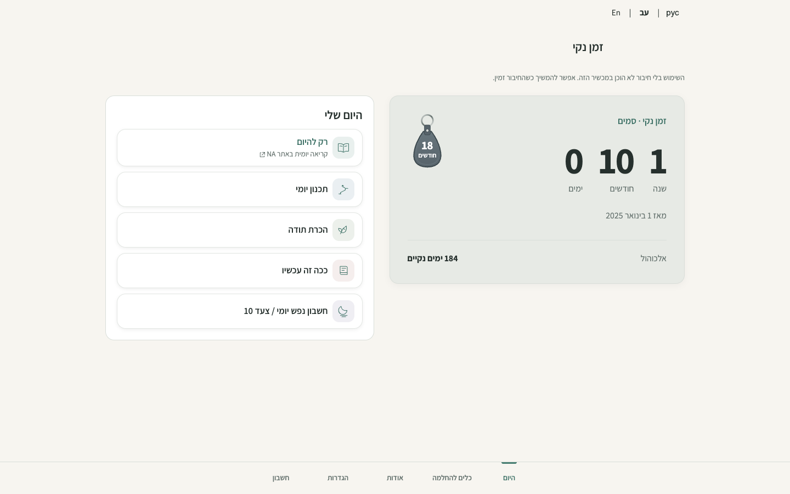
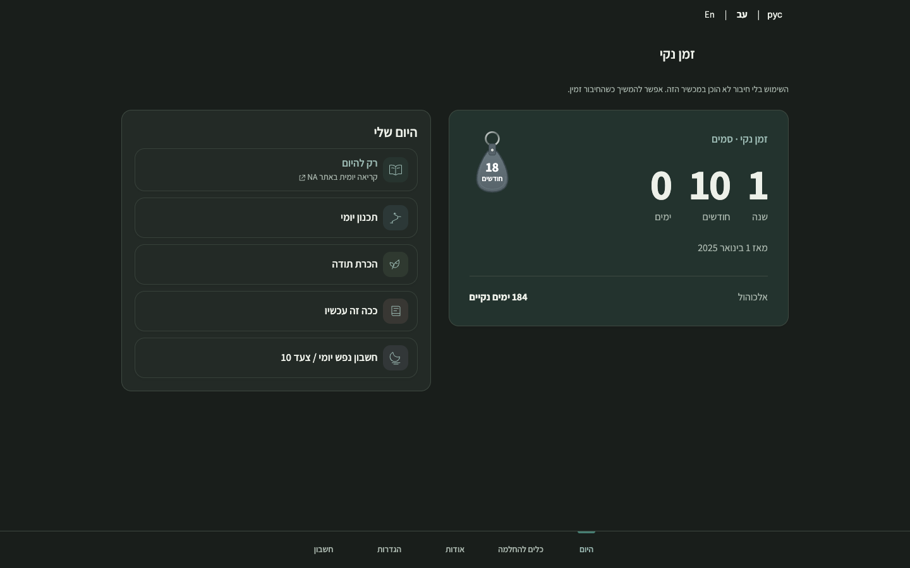
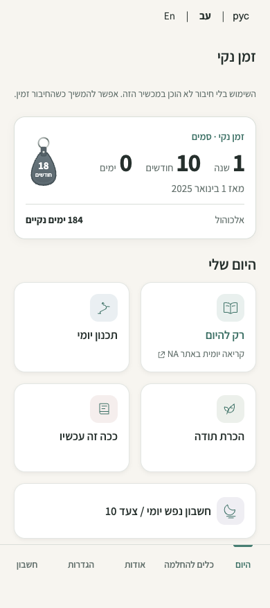

# Desktop Today composition — issue #75

The desktop Today screen places the existing recovery summary, optional secondary counter and milestone beside the five daily actions. From 1024px the actions form a vertical list in the same reading and keyboard order. Below that breakpoint the approved 2×2 plus full-width Step 10 layout remains. The fixed bottom navigation and existing destinations remain in place. No recovery data or service behavior changes.

## Owner feedback revision

The first desktop proposal was held by the owner because the short counter did not balance the action list. The revision gives the existing counter a larger, softly tinted focal surface, larger elapsed-time figures and keytag, and more deliberate spacing for the start date and optional second path. It uses a 1.1:1 column split within a 1080px maximum rather than 7:5 within 960px. The action list is more compact. The counter grows from its real contents; it is not stretched to the height of the list.

These fresh screenshots are actual Chromium captures of the protected Preview for application commit `416464c929a69b2c45bf1b8900160ef310aa4514`, using the same synthetic two-path guest fixture, fixed 1 November 2026 in Europe/Amsterdam, and a fresh browser context with service workers blocked. They show 1440×900 Hebrew RTL light/dark and 390×844 light. They do not show real user data. The earlier 1440px screenshot shows the held proposal for comparison.

| View | Held proposal | Revised Preview |
| --- | --- | --- |
| 1440 light |  |  |
| 1440 dark |  |  |
| 390 light |  |  |

The desktop balance assertion measures the summary relative to the action panel with this fixture (at least 70% of its height), verifies the larger figures and keytag, and checks that the date and secondary row occupy the card. This is a guard against the original imbalance, not a substitute for owner visual judgment. At 1920px the composition remains bounded to 1080px. Local matched 390px captures before and after the revision were byte-identical in both themes.

## Matched visual evidence

Synthetic guest fixture with two recovery paths; fixed 1 November 2026, Europe/Amsterdam. Local Chromium captures at 390×844 and 1440×900, using fresh contexts with service workers blocked. Before: main `f488523c7bc225f2494bc2ae12821cec478783e0`; after: this change. Screenshots are full-page; the visible fixed navigation stays at the viewport bottom. No real recovery data or accounts were used.

| View | Before | After |
| --- | --- | --- |
| 390 light |  |  |
| 390 dark |  |  |
| 1440 light |  |  |
| 1440 dark |  |  |

## Revision validation

Local Chromium: 1,221 assertions passed across desktop Today (28), guided Home (193), responsive (791), navigation (47), milestone (52), timers (25), internationalization (64) and offline (21). The milestone suite was rerun after updating its old desktop badge-size expectation; the overlap, visibility, preference and recovery-data checks still pass. Against the protected Preview at application commit `416464c929a69b2c45bf1b8900160ef310aa4514`, desktop Today, guided Home and milestone suites passed 273 assertions. Seven repository-hygiene tests, the static build, CSP hashes and `git diff --check` passed. Synthetic browser checks do not constitute owner approval or live account UAT.

## Earlier validation

Local Chromium: 1,204 assertions passed across guided Home, responsive, navigation, milestone, timers, visual polish, internationalization and offline suites. The responsive suite covers Hebrew, English and Russian in light and dark at 320, 390, 768, 1024 and 1440px and landscape sizes, enlarged text, overflow and fixed navigation clearance. Home checks cover action order, keyboard focus, destination and counter display preferences. An additional 26 checks cover a valid long secondary label, clearance and enlarged text. Seven repository hygiene tests, CSP hash verification and static build passed. These synthetic checks are not owner visual acceptance or live account UAT.

The change awaits owner visual approval; no production deployment or merge is authorized by this evidence.
