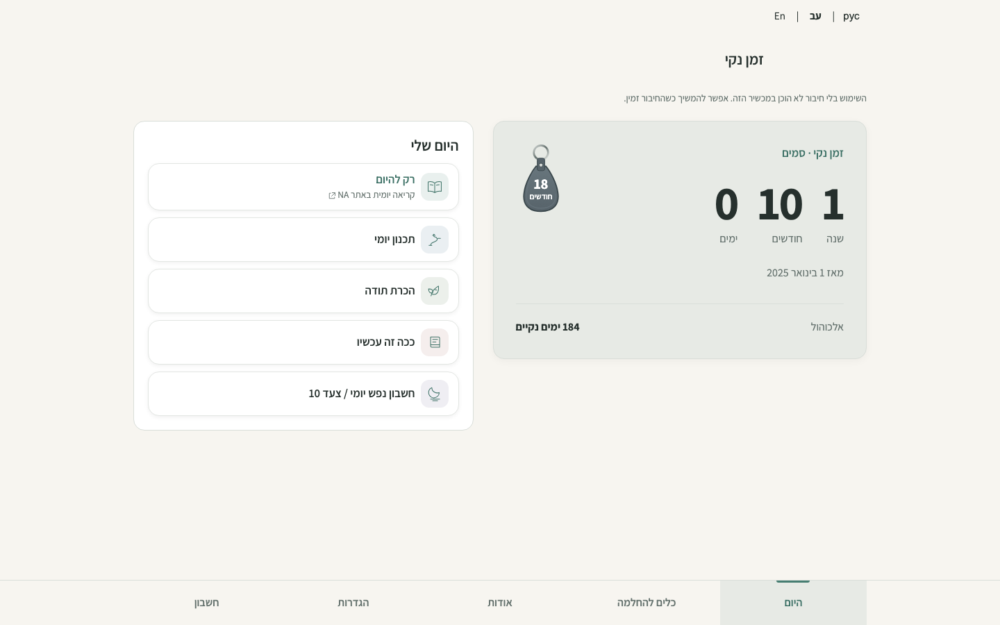
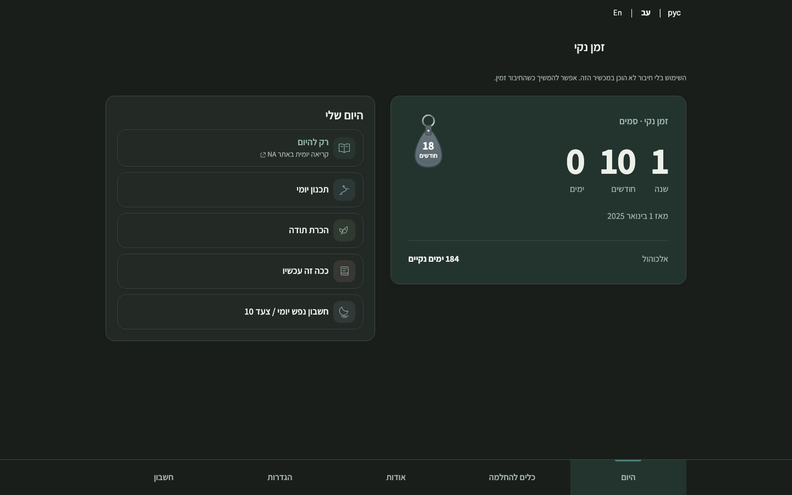
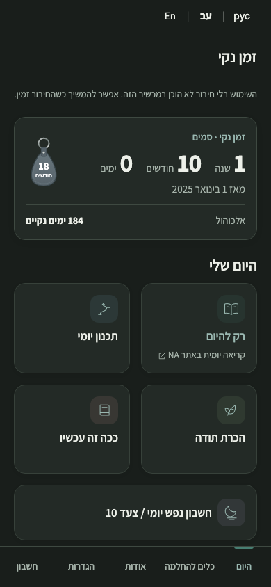

# Desktop Today composition — issue #75

The desktop Today screen places the existing recovery summary, optional secondary counter and milestone beside the five daily actions. From 1024px the actions form a vertical list in the same reading and keyboard order. Below that breakpoint the approved 2×2 plus full-width Step 10 layout remains. The fixed bottom navigation and existing destinations remain in place. No recovery data or service behavior changes.

## Checkpoint A — navigation revision (2026-11-01)

The existing [Draft PR #78](https://github.com/onahum2023/clean-time/pull/78)
now incorporates merged Welcome PR #79 (`efa2ab5`) through merge `ce7f28c`.
Application commit: `72c6385ebb3d69b588ec25779270785592007238`, version
`2026.11.01.9`. [Protected Preview](https://clean-time-epp8pwv7w-nu-cielo.vercel.app/).

The navigation keeps its full-width fixed background and exactly the same five
labels, order and destinations. It retains the compact layout below 600px,
grows with the shell at intermediate widths and aligns with Home from 1024px.
At 1440px both Home and the usable navigation region span x=192–1248, width
1056px: the existing 1120px shell minus two 32px gutters, within the shared
1080px Home ceiling. The previous navigation region was 520px. Desktop targets
are at least 64px tall, labels use 1rem and the current destination has a soft
tint and wider marker. The existing two-column Home composition is retained.

A footer ResizeObserver updates a presentation-only CSS variable. It reserves
space for wrapped Russian labels at 320px with 200% text as well as device
bottom insets. It writes no preferences or recovery state. The app/worker
versions and exact CSP hashes are updated; no storage, auth, encryption,
backup, sync, onboarding or theme logic changes.

### Actual Preview viewport captures

Fresh Chromium contexts, synthetic two-path guest fixture, fixed 1 November
2026 at 13:00 Europe/Amsterdam, fonts loaded and service workers blocked for
reproducibility. These are viewport screenshots, not cropped or full-page
composites: the complete fixed footer appears at its actual viewport bottom.
They come from the application Preview above. Documentation-only follow-up
commits do not change its application assets.

| Viewport | Light | Dark |
| --- | --- | --- |
| 1440×900 Hebrew RTL |  |  |
| 390×844 Hebrew RTL |  |  |

Matched local captures against `ce7f28c` are byte-identical for 390px Home in
both themes and for Welcome at 390px/1440px in both themes, including its full
page and closing privacy card (10 comparisons). These preservation artifacts
remain in ignored `qa-artifacts/issue-75-navigation-before/` and `-after/`.
The new layout assertion was also run against the baseline and failed at
1024px, specifically detecting the inherited 520px cap.

### Validation

- **Actual protected Preview: 989 assertions passed**, including navigation
  alignment/accessibility (462), desktop Today (28), guided Home (193) and
  merged Welcome (306). **102 additional deployed-browser workflow checks
  passed** at 1440px/390px. No document/asset/backend response mocks were used;
  only temporary origin-scoped authentication and synthetic guest data.
- Vercel reports READY for the exact application commit. The deployed smoke
  confirms guest-only backend configuration (`url:null`, `key:null`,
  `backupDisabled:true`), requested application assets and no JavaScript errors.
- All seven repository-hygiene/build guard tests, source hygiene scan,
  regenerated CSP hashes, Preview build and `git diff --check` pass.
- Latest passing local suite executions: **2,378 assertions**, covering the
  new navigation regression (462), responsive matrix (791), desktop/guided Home
  (221), Welcome (618), navigation (47), milestones (52), timers (25), i18n
  (64), offline (21), appearance/palette (67) and CSP (10).
- The existing synthetic guest workflow smoke runner also passes **102 local
  checks** at 1440px/390px, including Journal persistence, Step 10 save,
  print invocation/local PDF download, Settings, appearance and all five
  destinations.
- Navigation coverage includes Hebrew RTL and English/Russian LTR, light/dark,
  320/390/568/599/600/768/1023/1024/1440/1920px, equal hit targets, DOM/visual
  order, keyboard focus/activation, active state, overflow, last-action
  clearance, 200% enlarged text and 720×450 CSS reflow equivalent to 200%
  browser zoom on a 1440×900 display.
- The installed Chromium lacks native safe-area emulation. The test supplies
  equivalent 34px footer padding and checks measured clearance and the final
  action. Physical-device safe-area and native browser zoom acceptance remain
  separate from these emulations.

Reproduce local assertions against an isolated Preview build with
`QA_BASE_URL=http://127.0.0.1:8765 node tests/run-qa.js desktop-navigation-qa.js`.
Capture actual viewports with `tests/desktop-navigation-capture.js`;
`QA_BASE_URL` selects the exact Preview and `QA_CAPTURE_OUTPUT` the output
folder. Protected access uses an unexpired, same-project development OIDC token
in memory with the existing origin-scoped helper. An expired token from the
repository's pre-existing `.env.local` was avoided by running `vercel env run`
from a temporary directory linked to the same project; no protection rule or
existing local environment file was changed.

**HOLD for Checkpoint A owner visual approval.** Keep PR #78 Draft. No Nora
review, merge or Production deployment. Issues #76 and #77 remain untouched
until their preceding owner checkpoints are approved.

## Earlier composition evidence

## Owner feedback revision

The first desktop proposal was held by the owner because the short counter did not balance the action list. The revision gives the existing counter a larger, softly tinted focal surface, larger elapsed-time figures and keytag, and more deliberate spacing for the start date and optional second path. It uses a 1.1:1 column split within a 1080px maximum rather than 7:5 within 960px. The action list is more compact. The counter grows from its real contents; it is not stretched to the height of the list.

These fresh screenshots are actual Chromium captures of the protected Preview for application commit `416464c929a69b2c45bf1b8900160ef310aa4514`, using the same synthetic two-path guest fixture, fixed 1 November 2026 in Europe/Amsterdam, and a fresh browser context with service workers blocked. They show 1440×900 Hebrew RTL light/dark and 390×844 light. They do not show real user data. The earlier 1440px screenshot shows the held proposal for comparison.

| View | Held proposal | Revised Preview |
| --- | --- | --- |
| 1440 light |  |  |
| 1440 dark |  |  |
| 390 light |  |  |

The desktop balance assertion measures the summary relative to the action panel with this fixture (at least 70% of its height), verifies the larger figures and keytag, and checks that the date and secondary row occupy the card. This is a guard against the original imbalance, not a substitute for owner visual judgment. At 1920px the composition remains bounded to 1080px. Local matched 390px captures before and after the revision were byte-identical in both themes.

## Matched visual evidence

Synthetic guest fixture with two recovery paths; fixed 1 November 2026, Europe/Amsterdam. Local Chromium captures at 390×844 and 1440×900, using fresh contexts with service workers blocked. Before: main `f488523c7bc225f2494bc2ae12821cec478783e0`; after: this change. Screenshots are full-page; the visible fixed navigation stays at the viewport bottom. No real recovery data or accounts were used.

| View | Before | After |
| --- | --- | --- |
| 390 light |  |  |
| 390 dark |  |  |
| 1440 light |  |  |
| 1440 dark |  |  |

## Revision validation

Local Chromium: 1,221 assertions passed across desktop Today (28), guided Home (193), responsive (791), navigation (47), milestone (52), timers (25), internationalization (64) and offline (21). The milestone suite was rerun after updating its old desktop badge-size expectation; the overlap, visibility, preference and recovery-data checks still pass. Against the protected Preview at application commit `416464c929a69b2c45bf1b8900160ef310aa4514`, desktop Today, guided Home and milestone suites passed 273 assertions. Seven repository-hygiene tests, the static build, CSP hashes and `git diff --check` passed. Synthetic browser checks do not constitute owner approval or live account UAT.

## Earlier validation

Local Chromium: 1,204 assertions passed across guided Home, responsive, navigation, milestone, timers, visual polish, internationalization and offline suites. The responsive suite covers Hebrew, English and Russian in light and dark at 320, 390, 768, 1024 and 1440px and landscape sizes, enlarged text, overflow and fixed navigation clearance. Home checks cover action order, keyboard focus, destination and counter display preferences. An additional 26 checks cover a valid long secondary label, clearance and enlarged text. Seven repository hygiene tests, CSP hash verification and static build passed. These synthetic checks are not owner visual acceptance or live account UAT.

The change awaits owner visual approval; no production deployment or merge is authorized by this evidence.
