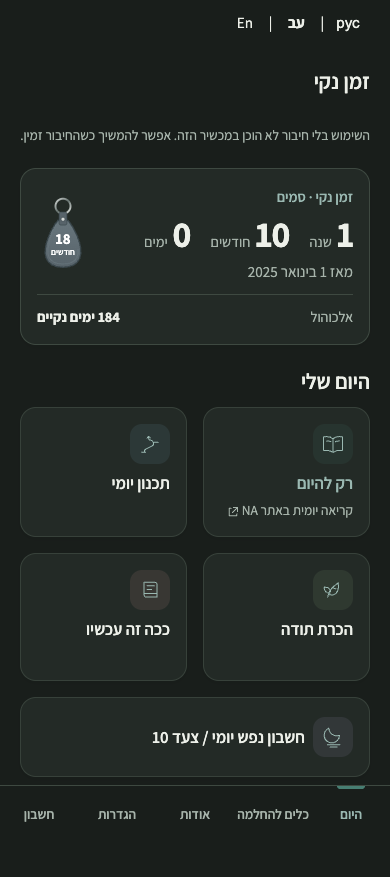
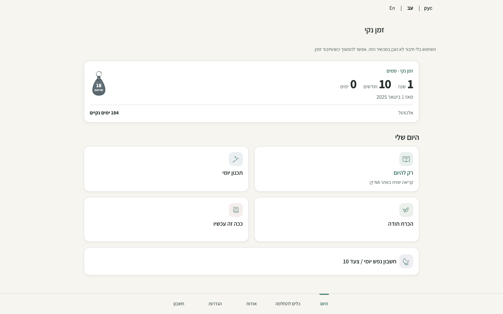
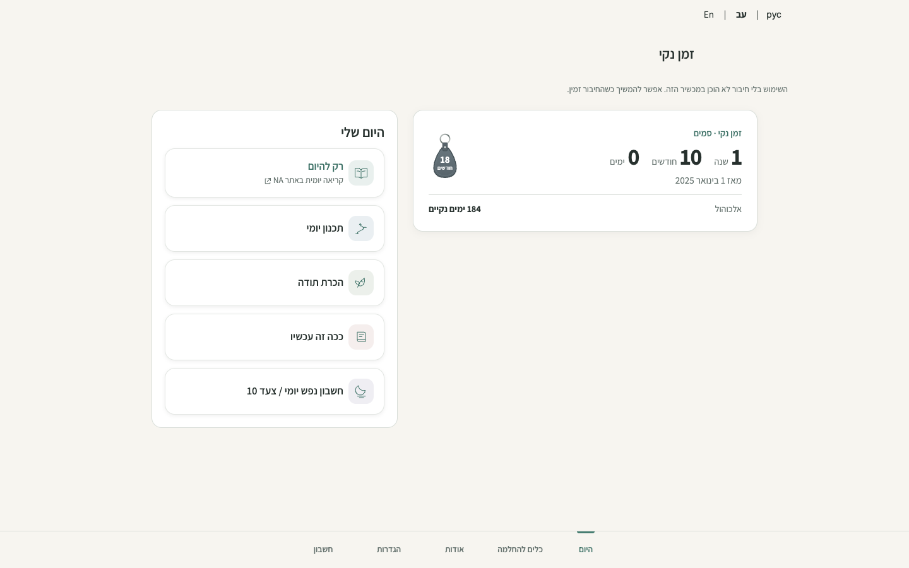
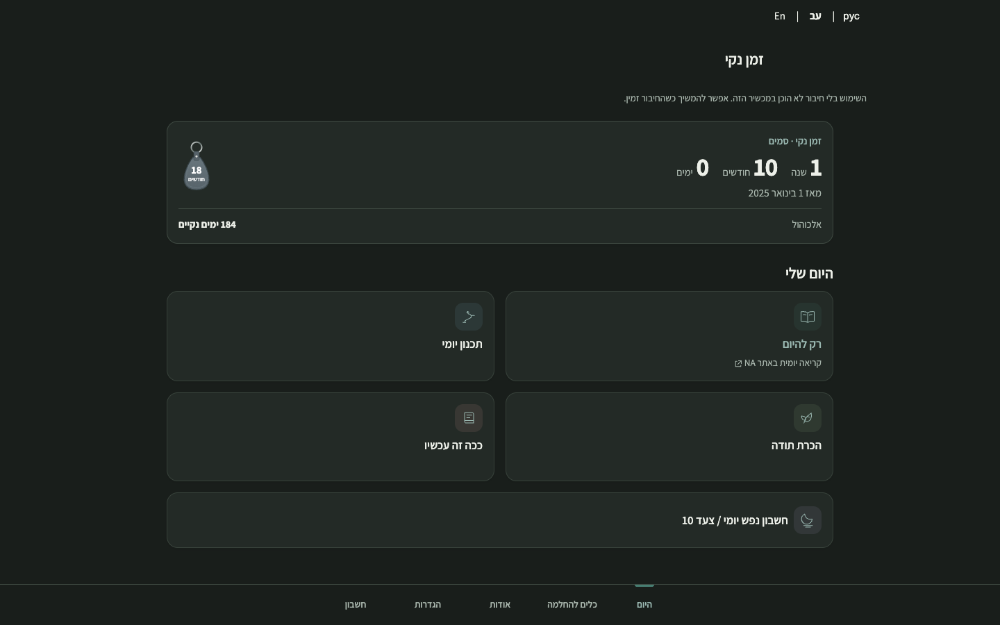
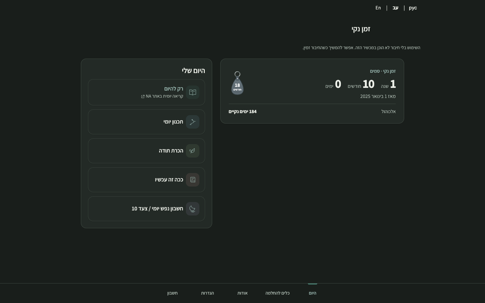

# Desktop Today composition — issue #75

The desktop Today screen places the existing recovery summary, optional secondary counter and milestone beside the five daily actions. From 1024px the actions form a vertical list in the same reading and keyboard order. Below that breakpoint the approved 2×2 plus full-width Step 10 layout remains. The fixed bottom navigation and existing destinations remain in place. No recovery data or service behavior changes.

## Matched visual evidence

Synthetic guest fixture with two recovery paths; fixed 1 November 2026, Europe/Amsterdam. Local Chromium captures at 390×844 and 1440×900, using fresh contexts with service workers blocked. Before: main `f488523c7bc225f2494bc2ae12821cec478783e0`; after: this change. Screenshots are full-page; the visible fixed navigation stays at the viewport bottom. No real recovery data or accounts were used.

| View | Before | After |
| --- | --- | --- |
| 390 light |  |  |
| 390 dark |  |  |
| 1440 light |  |  |
| 1440 dark |  |  |

## Validation

Local Chromium: 1,204 assertions passed across guided Home, responsive, navigation, milestone, timers, visual polish, internationalization and offline suites. The responsive suite covers Hebrew, English and Russian in light and dark at 320, 390, 768, 1024 and 1440px and landscape sizes, enlarged text, overflow and fixed navigation clearance. Home checks cover action order, keyboard focus, destination and counter display preferences. An additional 26 checks cover a valid long secondary label, clearance and enlarged text. Seven repository hygiene tests, CSP hash verification and static build passed. These synthetic checks are not owner visual acceptance or live account UAT.

The change awaits owner visual approval; no production deployment or merge is authorized by this evidence.
