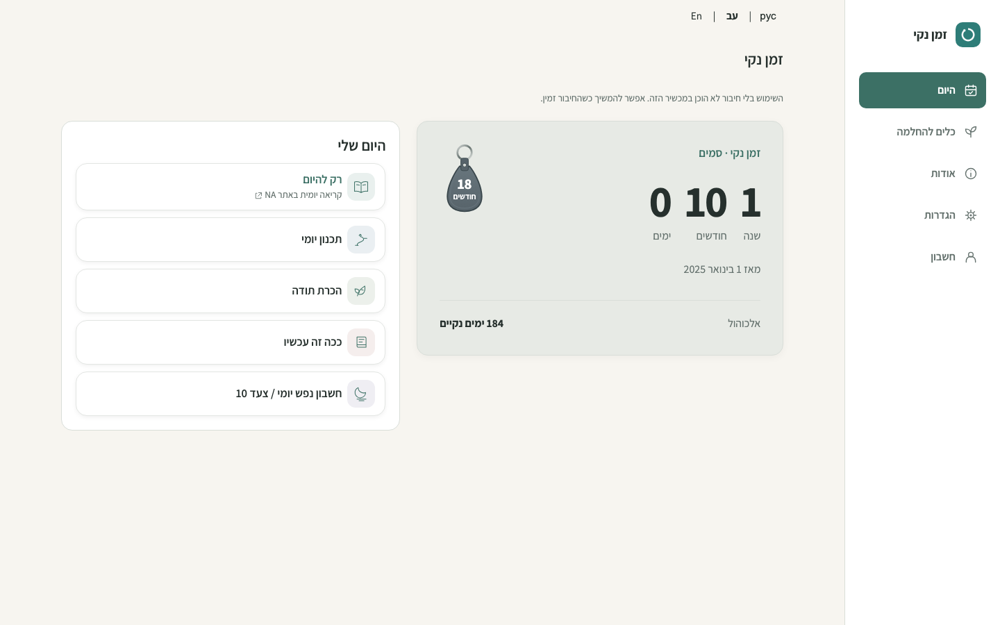
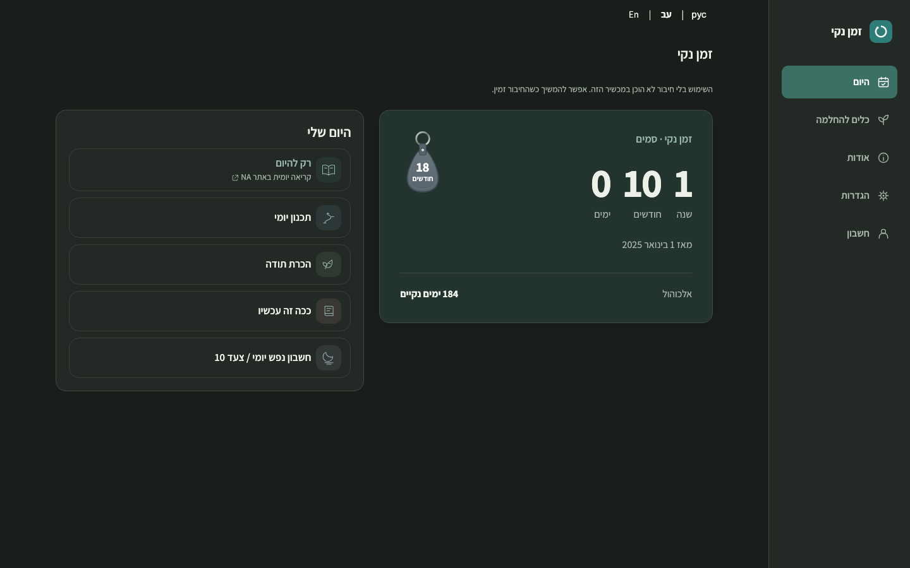
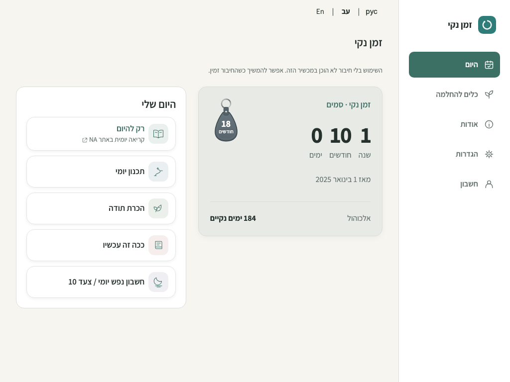
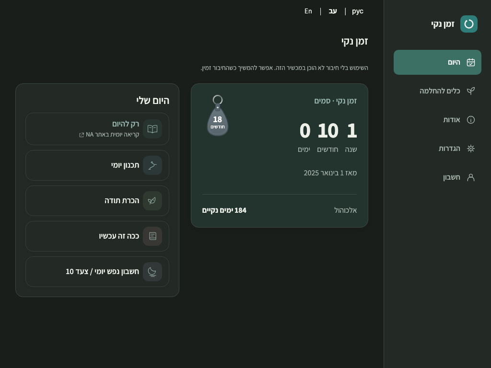
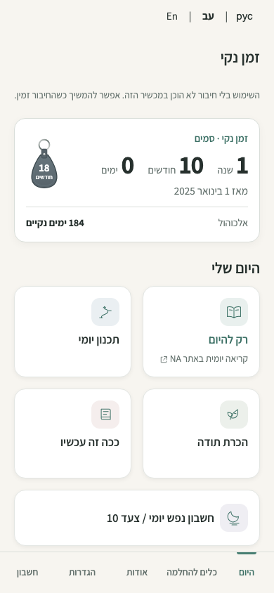

# Navigation-first desktop Home — PR #78

**HOLD for owner visual approval.** This revision supersedes the earlier desktop
bottom-navigation requirement and its prior visual acceptance. Navigation and
Home must be approved together before merge. No Nora review, merge or Production
deployment. Issues #76/#77 follow afterward; no theme implementation is included.

## Reference and adaptation

Adapted from [Lovable AppShell.tsx at `31108e3`](https://github.com/onahum2023/clean-time-tracker/blob/31108e3177236f900c0023bc3aa06c3506621d9d/src/components/AppShell.tsx):
224px reading-start rail, app identity, vertically arranged icon/label targets
and a clear filled current destination. The existing lightweight SPA is retained;
no React, router, framework, icon runtime or new remote asset was imported.
Merged Welcome PR #79 is already incorporated in this same Draft PR.

The reference has four destinations. Clean Time keeps its original **five**:
Today, Recovery Tools, About, Settings and Account, in their original DOM order.
One navigation DOM and the same handlers serve both layouts:

- **>=1024px:** persistent right rail in Hebrew RTL; left rail in English/Russian
  LTR. All application content occupies the remaining viewport region. Targets
  are at least 52px tall with 1rem labels, visible keyboard focus and
  `aria-current=page`. The rail scrolls vertically in short/enlarged windows so
  Account remains reachable.
- **<1024px:** the original compact fixed bottom navigation, with unchanged
  labels, widths, targets and mobile Home treatment. Identity and rail icons are
  hidden. Existing safe-area padding and measured content clearance remain.
- **Entry screens:** Welcome, guest setup, startup and authentication have no
  application navigation or rail offset. Auth Back restores the application
  shell when appropriate. Public pre-setup About remains outside the shell.
- **Inner screens:** Plan, Gratitude, Journal, Step 10, Meditation, Recovery
  Tools, Bookmarks, Readings, Settings, Counter Details, Account, About and
  Feedback share the same shell. Journal/confirmation modals retain their
  existing full-viewport modality and focus trapping; print/PDF excludes the
  application chrome as before.

## Reassessed Home composition

The rail is accounted for before sizing Home. Its content ceiling is 1040px,
with a 1.08:1 panel split, 24px gap and responsive counter padding/numbers.
At 1440px: rail x=1216–1440, Home x=88–1128 (1040px). At 1024px:
rail x=800–1024, Home x=32–768 (736px). LTR mirrors these regions.
Header, language bar and status notices align with the content region.
The desktop footer reservation is removed. Counter/date/secondary-row spacing
and the smaller 1024px keytag leave room for the action panel without forcing
an empty equal-height card. All five daily actions remain directly accessible.

No recovery records, preferences, authentication, encryption, backup or sync
logic changes. Application/worker version and exact CSP hashes are refreshed.

## Actual protected Preview and screenshots

Application commit: `5f435b9658c342892fb39ac8dc89045dce677d42`, version
`2026.11.01.10`. [Protected application Preview](https://clean-time-679ffvrko-nu-cielo.vercel.app/).
The evidence follow-up changes documentation/screenshots only.

These are actual Chromium **viewport** captures from that Preview, using the
synthetic two-path guest fixture and exact sizes below. The whole rail or mobile
footer is included; no crops or stitched full-page compositions. Service workers
are blocked in the reproducible capture context, so the app truthfully displays
its existing offline-preparation notice. Separate offline tests run the real
worker. No application document/asset/backend responses are mocked; temporary
same-project authentication is supplied only to the exact Preview origin.

| Hebrew RTL viewport | Light | Dark |
| --- | --- | --- |
| 1440×900 |  |  |
| 1024×768 |  |  |
| 390×844 |  |  |

Reproduce with `tests/desktop-navigation-capture.js`, setting `QA_BASE_URL` to
the exact Preview origin and `QA_CAPTURE_OUTPUT` to the output directory.

## Validation

The actual protected application Preview passes **1,083 assertions**: navigation
rail/footer (556), desktop Today (28), guided Home (193) and Welcome (306).
The deployed guest workflow runner passes **102 additional checks**. Its browser
requests confirm disabled Preview backend configuration (`url:null`, `key:null`,
`backupDisabled:true`), fetched application assets and no JavaScript errors.
All six deployed Home screenshots are byte-identical to the corresponding
local captures. These are synthetic browser checks, not owner acceptance.

Latest passing local executions total **3,176 browser assertions**:

| Suite | Assertions |
| --- | ---: |
| Shared rail/footer, entry exclusion, keyboard, locales, zoom/text | 556 |
| Responsive matrix across application screens | 1,379 |
| Desktop Today / guided Home | 28 / 193 |
| Registered account / signed-in Home summary | 43 / 53 |
| Welcome foundation / entry flows | 306 / 312 |
| Navigation / milestones / timers / i18n | 47 / 52 / 25 / 64 |
| Offline / modals / CSP | 21 / 20 / 10 |
| Existing appearance palette / preferences | 8 / 59 |

An additional **102 local guest workflow checks** cover Journal writing/reload,
Step 10 save, print invocation/local PDF download, Settings, appearance
persistence and all five navigation destinations. Registered coverage uses
synthetic SDK mocks; hosted Preview is guest-only and never uses live accounts.

The signed-in Home summary test retained its name/hidden-row/data assertions;
its old pre-polish 110px mobile card limit was corrected to account for the
already-merged padding/keytag treatment. No mobile application behavior changed.

Navigation checks include 320/390/568/768/1023/1024/1440/1920px, Hebrew RTL and
English/Russian LTR, light/dark, all five keyboard activations/current states,
short-window rail scrolling, 200% text, and a 720×450 CSS viewport representing
200% desktop zoom reflow. A simulated 34px bottom inset checks mobile clearance.
Native browser zoom, physical safe areas and assistive-technology acceptance
remain manual; these emulations do not imply physical-device UAT.

Matched local captures are byte-identical to the preceding PR #78 application
for mobile Home light/dark and Welcome at 390px/1440px light/dark, including
full-page views (10 comparisons). All fixtures are synthetic, fixed to
1 November 2026 at 13:00 Europe/Amsterdam, with self-hosted fonts loaded.

Seven repository-hygiene/build guard tests, source hygiene, JavaScript syntax,
CSP hash validation, Preview build and `git diff --check` pass.
