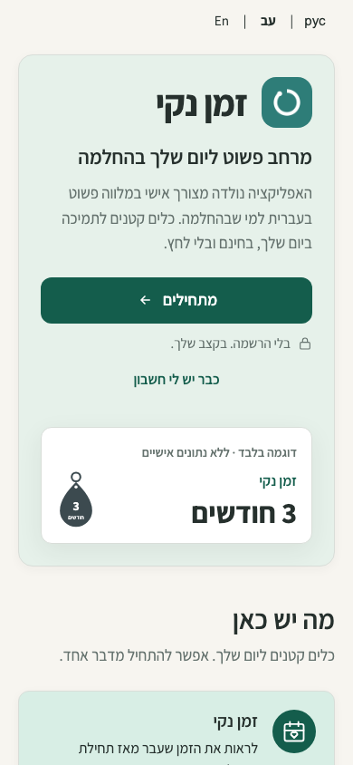
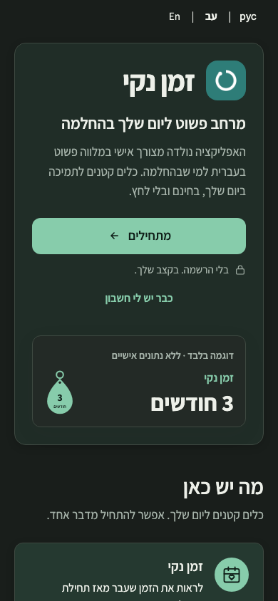
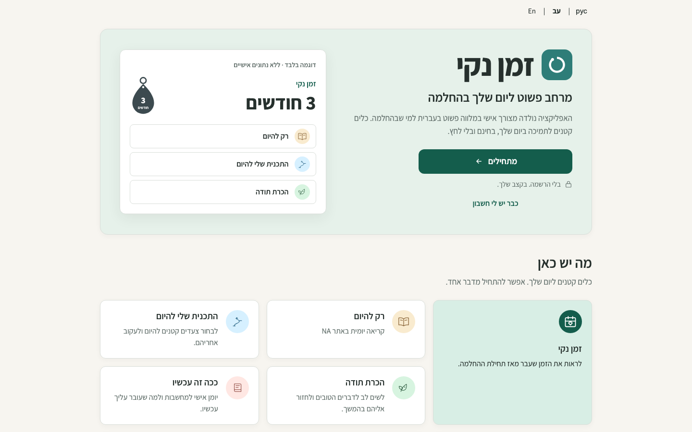

# Welcome visual foundation — owner review

This is the pre-onboarding Welcome deliverable of [issue #77](https://github.com/onahum2023/clean-time/issues/77). It starts from merged main `f488523c7bc225f2494bc2ae12821cec478783e0`. It is independent of PR #78. Owner visual approval is required; keep the PR draft. No Nora review, merge or Production release.

## Design adaptation

The implementation follows the actual Lovable source at [`clean-time-tracker` commit `31108e3177236f900c0023bc3aa06c3506621d9d`](https://github.com/onahum2023/clean-time-tracker/tree/31108e3177236f900c0023bc3aa06c3506621d9d):

| Reference | Adaptation in the existing SPA |
| --- | --- |
| `src/routes/index.tsx`, `Welcome` | Wide two-column hero, first-action placement, sample counter with daily-tool rows, and feature overview. The mobile example becomes a compact counter; repeated reassurance cards, quote and repeated start buttons are omitted. |
| `src/styles.css` | Actual forest-primary, soft surface and five practice-tone OKLCH values, including dark variants. Rounded cards, small shadows, spacing and typography follow the reference. |
| `src/components/Keytag.tsx` | Static SVG geometry adapted directly, with localized month label. The sample is explicitly labeled, accessible and never saved. |
| `src/components/AppShell.tsx` and `PracticeArtwork.tsx` | Card/button/focus conventions and circular practice-tone treatment. Destination drawings are reused from the current SPA so existing screens retain their familiar icons. No React, Tailwind or Lucide runtime is imported. |
| Existing app assets | Self-hosted Assistant font and Clean Time logo are retained. Lovable's optional scenic images are not required for its default color-only Welcome design. No new image, font request, dependency or service is introduced. |

`assets/welcome.css` holds named presentation tokens and card/icon primitives under `#welcome`. The only shell override is `.app.landing`, which is active only on Welcome. No inner-screen theme or navigation rules are changed. All five daily actions, the clean-time counter and Recovery Tools have an explanation. The privacy copy distinguishes guest-local use from optional encrypted account backup/sync, with free/noncommercial wording and the existing About/privacy destination.

## Matched Hebrew RTL captures

Fresh synthetic Chromium contexts, fixed 1 November 2026 at 13:00 Europe/Amsterdam, self-hosted fonts loaded, real service-worker initialization, 390×844 and 1440×900. Before uses the exact main commit above; after uses this branch. There is no recovery state on Welcome. “3 months” is static illustrative content, not a synthetic account or stored recovery record.

| Viewport/theme | Before | After |
| --- | --- | --- |
| 390 light |  |  |
| 390 dark |  |  |
| 1440 light |  |  |
| 1440 dark |  |  |

Full-page captures of every view are alongside these images, with `-full` appended before `.png`. [Desktop light full page](issue-77-visuals/after-1440-light-full.png) and [mobile light full page](issue-77-visuals/after-390-light-full.png) show the complete feature overview and privacy section. The shorter images above show the actual initial viewport and primary-action visibility.

Reproduce with `node tests/welcome-capture.js before|after`; `QA_BASE_URL` selects the isolated loopback baseline or exact protected Preview. The capture helper uses fresh browser contexts and never reads an existing browser profile.

## Regression evidence

Application JavaScript, except the required version bump to `2026.11.01.7`, matches main byte for byte. All markup from the existing onboarding section onward also matches main byte for byte. No storage, authentication, encryption, synchronization, database or recovery-content logic changed. The static publication and offline-shell allowlists include the new scoped stylesheet; CSP hashes were refreshed for the version bump without broadening the policy.

Matched synthetic captures of guest setup and Today are byte-identical to main in all eight comparisons: two screens × 390/1440px × light/dark. These local comparison artifacts remain in ignored `qa-artifacts/issue-77/`; they contain only the same fixed synthetic fixture.

Targeted Welcome checks cover the unchanged guest setup/persistence/back paths, returning login, About/privacy, keyboard order and focus, seven static feature cards, a labeled unsaved example, measured text/icon/CTA contrast, three locales, 320px/390px/1440px, both themes, enlarged text and no overflow. Existing account/sync tests use synthetic SDK mocks; they are not live-account acceptance.

Local Chromium regression coverage: **2,816 passing assertions**, counting the broad run plus the two resolved-suite reruns. The initial Home/Welcome shared-style expectation was adapted to assert the unchanged Home treatment, then its 193 checks passed. The 28 PDF-output checks passed using the already bundled `pdf-lib` package through `NODE_PATH`, with no installation or repository dependency changes. Seven Node repository-hygiene tests, JavaScript syntax checks, CSP hash verification, clean isolated Preview build and `git diff --check` pass.

One pre-existing suite remains red: `home-account-summary-qa.js` fails its compact-summary height expectation on unchanged main at Hebrew 320px as well as this branch. That suite is not counted as passing. No inner-screen change was made to resolve it. Physical-device and live-account acceptance are outside these synthetic checks.

Preview URL, deployed SHA and deployed smoke results will be added after the branch deployment.
