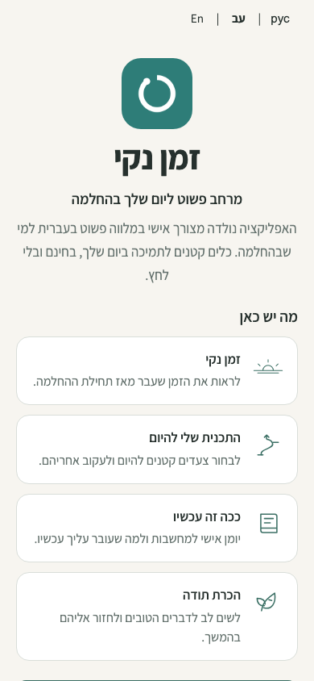
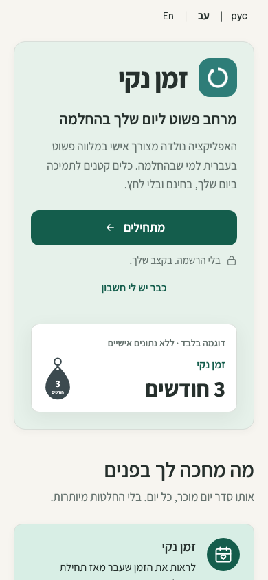
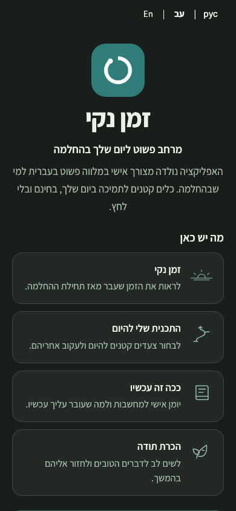
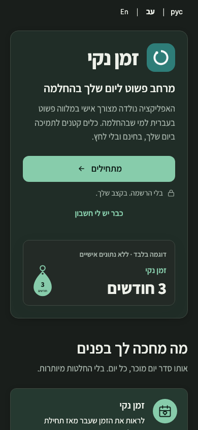
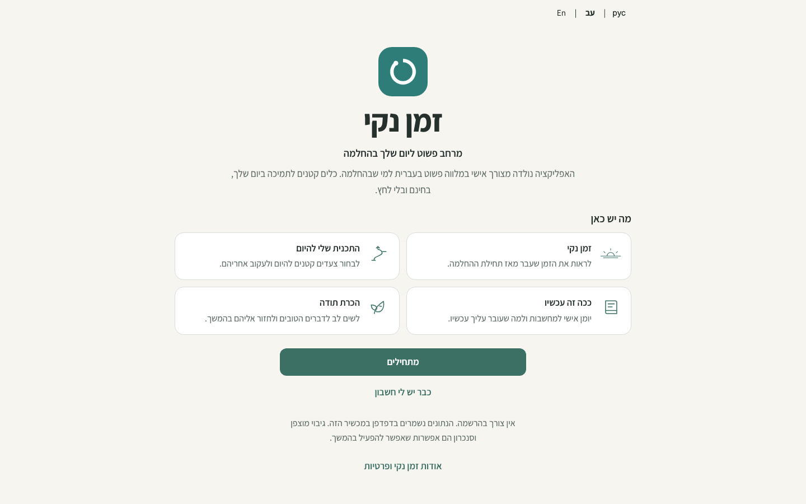
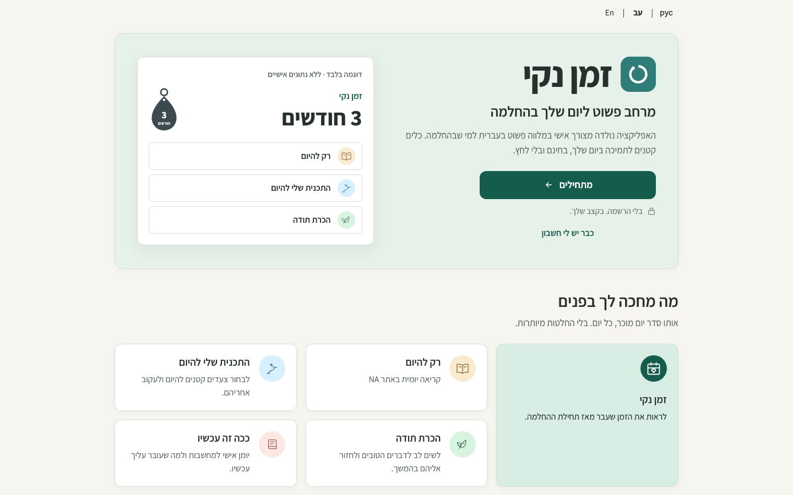
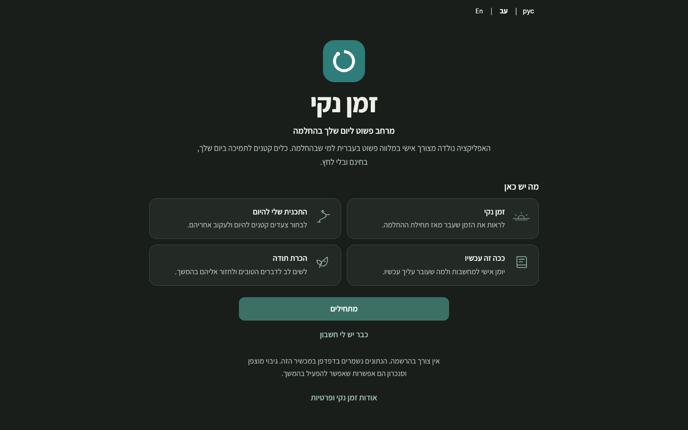
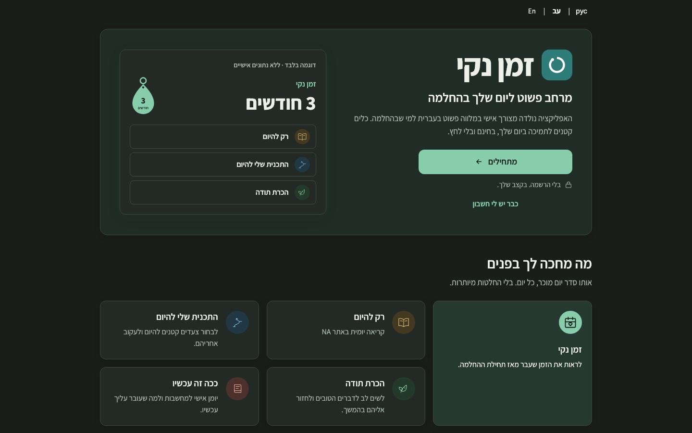

# Welcome visual foundation — owner review

This is the pre-onboarding Welcome deliverable of [issue #77](https://github.com/onahum2023/clean-time/issues/77). It starts from merged main `f488523c7bc225f2494bc2ae12821cec478783e0`. It is independent of PR #78. Owner visual approval is required; keep the PR draft. No Nora review, merge or Production release.

## Owner feedback revision

The [owner’s November 1 feedback](https://github.com/onahum2023/clean-time/pull/79#issuecomment-6560757458) is implemented on the same draft PR:

- Feature heading: **מה מחכה לך בפנים**.
- Subtitle: **אותו סדר יום מוכר, כל יום. בלי החלטות מיותרות.**
- The former privacy strip is now a centered, softly tinted closing card with the requested reflection, a second **מתחילים** CTA, lock-icon privacy reassurance and a direct public **פרטיות** link to `/privacy/`. About remains separately available.
- Both Start elements have unique IDs and share the exact existing `onclick` function. The hero remains the first action above the fold. The closing CTA opens the existing guest setup, with no new path or persistence behavior.
- New copy is translated through the existing English/Russian catalog. The privacy wording continues to distinguish guest-local data from optional encrypted account backup and sync.

## Design adaptation

The implementation follows the actual Lovable source at [`clean-time-tracker` commit `31108e3177236f900c0023bc3aa06c3506621d9d`](https://github.com/onahum2023/clean-time-tracker/tree/31108e3177236f900c0023bc3aa06c3506621d9d):

| Reference | Adaptation in the existing SPA |
| --- | --- |
| `src/routes/index.tsx`, `Welcome` | Wide two-column hero, first-action placement, sample counter with daily-tool rows, and feature overview. The mobile example becomes a compact counter. Repeated promotional sections are omitted; the owner-requested reflection and second Start action appear once in the closing privacy card. |
| `src/styles.css` | Actual forest-primary, soft surface and five practice-tone OKLCH values, including dark variants. Rounded cards, small shadows, spacing and typography follow the reference. |
| `src/components/Keytag.tsx` | Static SVG geometry adapted directly, with localized month label. The sample is explicitly labeled, accessible and never saved. |
| `src/components/AppShell.tsx` and `PracticeArtwork.tsx` | Card/button/focus conventions and circular practice-tone treatment. Destination drawings are reused from the current SPA so existing screens retain their familiar icons. No React, Tailwind or Lucide runtime is imported. |
| Existing app assets | Self-hosted Assistant font and Clean Time logo are retained. Lovable's optional scenic images are not required for its default color-only Welcome design. No new image, font request, dependency or service is introduced. |

`assets/welcome.css` holds named presentation tokens and card/icon primitives under `#welcome`. The only shell override is `.app.landing`, which is active only on Welcome. No inner-screen theme or navigation rules are changed. All five daily actions, the clean-time counter and Recovery Tools have an explanation. The privacy copy distinguishes guest-local use from optional encrypted account backup/sync, with free/noncommercial wording, the public Privacy page and the existing About destination.

## Matched Hebrew RTL captures

Fresh synthetic Chromium contexts, fixed 1 November 2026 at 13:00 Europe/Amsterdam, self-hosted fonts loaded, real service-worker initialization, 390×844 and 1440×900. Before uses the exact main commit above; revised uses this branch after owner feedback. There is no recovery state on Welcome. “3 months” is static illustrative content, not a synthetic account or stored recovery record.

| Viewport/theme | Before | Revised |
| --- | --- | --- |
| 390 light |  |  |
| 390 dark |  |  |
| 1440 light |  |  |
| 1440 dark |  |  |

Full-page captures of every view are alongside these images, with `-full` appended before `.png`. [Desktop light full page](issue-77-visuals/revised-1440-light-full.png) and [mobile light full page](issue-77-visuals/revised-390-light-full.png) show the complete feature overview and privacy section. The shorter images above show the actual initial viewport and primary-action visibility.

Reproduce with `node tests/welcome-capture.js revised`; `QA_BASE_URL` selects the isolated loopback baseline or exact protected Preview. The capture helper uses fresh browser contexts and never reads an existing browser profile.

## Regression evidence

Application JavaScript differs from main only in the required version bump to `2026.11.01.8` and a single binding that assigns the existing Start handler to the closing CTA. All post-Welcome screen markup is unchanged. No storage, authentication, encryption, synchronization, database or recovery-content logic changed. The static publication and offline-shell allowlists include the scoped Welcome stylesheet; CSP hashes were refreshed without broadening the policy.

Matched synthetic captures of guest setup and Today are byte-identical to main in all eight comparisons: two screens × 390/1440px × light/dark. These local comparison artifacts remain in ignored `qa-artifacts/issue-77/`; they contain only the same fixed synthetic fixture.

Targeted Welcome checks cover the unchanged guest setup/persistence/back paths, returning login, About/privacy, keyboard order and focus, seven static feature cards, a labeled unsaved example, measured text/icon/CTA contrast, three locales, 320px/390px/1440px, both themes, enlarged text and no overflow. Existing account/sync tests use synthetic SDK mocks; they are not live-account acceptance.

Current revision: **618 targeted Welcome assertions pass**. They cover exact Hebrew headline/subtitle/reflection, translated copy, both Start actions and shared handler identity, no duplicate IDs, direct public Privacy navigation, keyboard order/focus, closing-card contrast, all requested sizes and locales, and unsaved illustrative data. Another **1,302 existing regression assertions pass** across guided Home, navigation, static SEO, offline/PWA, i18n, recovery/returning-account flows, responsive layouts and visual polish, for **1,920 passing assertions in this revision**. Seven Node repository-hygiene tests, JavaScript syntax checks, CSP hash verification, clean isolated Preview build and `git diff --check` pass.

The earlier foundation run passed 2,816 assertions across 34 suites, including mocked account/encryption/sync/upgrade coverage. Those earlier totals are historical and are not claimed as rerun for this focused revision.

One pre-existing suite remains red: `home-account-summary-qa.js` fails its compact-summary height expectation on unchanged main at Hebrew 320px as well as this branch: the assertion requires less than 110px, while merged main measures about 154px. The same baseline probe confirms the name appears once, both repeated-label rows are hidden, the first action clears the footer and there is no horizontal overflow. That suite is not counted as passing. No inner-screen change was made to resolve it. Physical-device and live-account acceptance are outside these synthetic checks.

## Protected Preview

- **URL:** [Protected revised Preview](https://clean-time-5dq4v6wro-nu-cielo.vercel.app/)
- **Status / target:** READY / Preview, `clean-time` in the NuCielo team.
- **Deployed application commit:** `a69d3992e96fc2b3d61e95284d24c2c46183078d`.
- **Build duration:** approximately 3 seconds.

Vercel Authentication remains enabled. Verification uses read-only, same-origin authenticated `vercel curl` asset requests through `tests/preview-cli-access.js`; credentials stay inside the CLI. No environment-variable download or public share token is needed.

Fresh captures use the `revised` and `revised-preview` prefixes; `-footer.png` adds a useful viewport capture of the closing card, alongside initial viewport and full-page captures. All **12 deployed captures are byte-identical** to the matching local revision captures. The earlier `after` and `preview` images are retained as historical comparisons.

| Closing card | Light | Dark |
| --- | --- | --- |
| 390px | [Mobile light](issue-77-visuals/revised-preview-390-light-footer.png) | [Mobile dark](issue-77-visuals/revised-preview-390-dark-footer.png) |
| 1440px | [Desktop light](issue-77-visuals/revised-preview-1440-light-footer.png) | [Desktop dark](issue-77-visuals/revised-preview-1440-dark-footer.png) |

The evidence-only follow-up commit changes documentation and screenshots, with application files identical to the deployed application commit above. The deployed Welcome, Welcome foundation, guided Home and visual-polish suites pass **822 assertions**, including both Start actions and the public Privacy route.

**Keep draft. Renewed owner visual approval is required. No Nora review, merge or Production deployment.**
