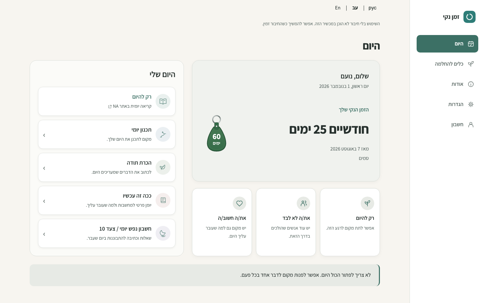

# PR #81 — Home column balance refinement

[Draft PR #81](https://github.com/onahum2023/clean-time/pull/81) ·
[Updated protected Preview](https://clean-time-9q38lwpjx-nu-cielo.vercel.app/) ·
[Integrated UAT checklist](ISSUE-80-INTEGRATED-UAT.md)

**HOLD for owner visual review. No merge or Production deployment.**
This visual refinement addresses the remaining unused vertical space between
Home's three supporting cards and its full-width reflection strip.

## Refinement

The desktop timer is now a stronger anchor, with a 360px minimum height at 1440px.
Its greeting uses the existing saved profile name when available, rendered as
plain text. Without a name it shows a simple localized hello. Today's localized
weekday/date now sits inside the timer beneath that greeting. Calendar duration,
start date, recovery identity and the optional milestone remain grouped below.
If a recovery label exactly repeats the greeting's saved name, that duplicate
identity line is hidden; no saved value is changed.

The supporting-card row has a 200px minimum height and roomier padding. The whole
counter/supporting-card column fills its existing desktop grid row, so the gap
from those cards to the reflection is just the normal 24px grid gutter at 1440px
(20px at the 1024px threshold). Content can grow with long names, translations,
text enlargement and secondary-counter details. The two-column order, rail,
action destinations and calm palette surfaces stay intact.

The greeting/date block is desktop-only. Mobile retains its approved summary,
2×2 daily-action grid, full-width Step 10 and five-destination fixed footer.
No new settings, content feeds, scheduling, requests, storage keys or backend
connections are introduced. Existing name/date data is only read for display.

## Fresh actual protected-Preview screenshots

All images below are browser captures from application commit
`caa274812a64762aa61175d85528216926ac84f8`, version `2026.11.01.14`, at the
protected Preview above. They use synthetic records, primary start date
7 August 2026 and a fixed 1 November 2026, 13:00 Europe/Amsterdam clock.
The named examples use the synthetic saved profile name **נועם**; no account
creation, personal identity or backend access is involved.

| 1440×900 desktop | Light | Dark |
| --- | --- | --- |
| Original, named greeting | [View](pr-81-home-balance-visuals/home-named-original-1440-light.png) | [View](pr-81-home-balance-visuals/home-named-original-1440-dark.png) |
| Forest, named greeting | [View](pr-81-home-balance-visuals/home-named-forest-1440-light.png) | [View](pr-81-home-balance-visuals/home-named-forest-1440-dark.png) |
| Original, no saved name | [View](pr-81-home-balance-visuals/home-original-1440-light.png) | [View](pr-81-home-balance-visuals/home-original-1440-dark.png) |
| Forest, no saved name | [View](pr-81-home-balance-visuals/home-forest-1440-light.png) | [View](pr-81-home-balance-visuals/home-forest-1440-dark.png) |

Compare with the [previous 1440px composition](pr-81-home-visuals/home-original-1440-light.png):
the new timer and taller supporting cards now reach the same lower edge as the
action column, leaving only the normal gutter above the reflection strip.

| Responsive samples | Light | Dark |
| --- | --- | --- |
| Original / 1024×768 | [View](pr-81-home-balance-visuals/home-original-1024-light.png) | [View](pr-81-home-balance-visuals/home-original-1024-dark.png) |
| Forest / 1024×768 | [View](pr-81-home-balance-visuals/home-forest-1024-light.png) | [View](pr-81-home-balance-visuals/home-forest-1024-dark.png) |
| Original / 390×844 | [View](pr-81-home-balance-visuals/home-original-390-light.png) | [View](pr-81-home-balance-visuals/home-original-390-dark.png) |
| Forest / 390×844 | [View](pr-81-home-balance-visuals/home-forest-390-light.png) | [View](pr-81-home-balance-visuals/home-forest-390-dark.png) |

Separate full-page captures include [1440px named light](pr-81-home-balance-visuals/home-named-original-1440-light-full.png),
[1440px named dark](pr-81-home-balance-visuals/home-named-original-1440-dark-full.png),
[1024px light](pr-81-home-balance-visuals/home-original-1024-light-full.png) and
[1024px dark](pr-81-home-balance-visuals/home-original-1024-dark-full.png).
Optional-secondary-counter views use the prior handoff fixture:
[desktop light](pr-81-home-balance-visuals/home-1440-light.png),
[desktop dark](pr-81-home-balance-visuals/home-1440-dark.png),
[mobile light](pr-81-home-balance-visuals/home-390-light.png),
[mobile dark](pr-81-home-balance-visuals/home-390-dark.png).

Fonts are loaded before capture. These are full browser viewports, with separate
`-full` images for scrollable content. No document/static-asset/backend responses
are mocked. Service workers are blocked for deterministic captures, so the
existing offline-preparation notice remains visible. Real offline/cache upgrades
are checked separately. Origin-scoped Preview credentials stay in memory.

## Validation

- **1,867 local assertions pass**, with zero failed suites in this refinement run:
  Home refinement (139), desktop composition (28), synthetic registered summary
  (53), guided Home/preferences (193), milestone/calendar (56), all-screen 200%
  text/themes (762), navigation (556), offline (21), preference/data upgrades (59).
- **1,734 actual protected-Preview UI assertions pass**, with zero failed suites:
  Home refinement (139), composition (28), guided Home (193), milestone/calendar
  (56), enlarged text/themes (762) and navigation (556).
- **106 deployed workflow checks pass** at 1440px/390px, including appearance
  persistence, exact recovery bytes, Journal reload, Step 10 save/print/PDF and
  the existing guest-only Preview backend boundary.
- **12,096 actual Home text/surface combinations pass** at rest/real hover,
  now including the in-card greeting/date, across all palettes/backgrounds/device
  accents and light/dark. Hebrew RTL and English/Russian LTR, 320/390/1024/1440px,
  keyboard actions, 200% text and existing counter preferences are covered.
- **10 actual deployed preservation images are byte-identical** to the previous
  handoff: mobile Home light/dark plus desktop/mobile Welcome viewport/full-page
  captures. The fresh gallery contains 40 deployed PNGs, including named examples.
- **10 Node contract/build tests pass**, including 3,240 startup compatibility
  combinations. Exact CSP hashes, Preview build, publication/source hygiene,
  documentation links, image dimensions and whitespace checks pass.

The new geometry assertions require the larger timer/supporting cards and check
that the supporting-card-to-reflection gap equals the grid gutter in all three
languages, both modes and both desktop widths. Name checks cover safe literal
rendering, missing-name fallback, duplicate-label suppression via the registered
summary regression, and unchanged recovery bytes after rendering/reload.
These scoped refinement checks supplement the earlier full integrated regression
coverage linked from the UAT checklist; they are not a new full 41-suite run.
No real accounts, cloud data, recovery exports or credentials are published.

English/Russian wording, native browser zoom, physical mobile keyboards/safe
areas, screen readers and installed-PWA behavior remain target-device acceptance
checks. Automation checks 200% text/reflow, keyboard behavior and responsive
bounds; it does not replace owner visual acceptance. The Preview retains its
existing guest-only configuration. Live auth/cloud-backup UAT and all new backend
or dynamic-content work stay deferred.
