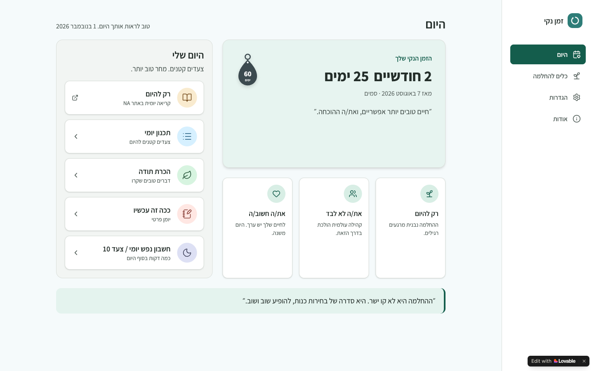
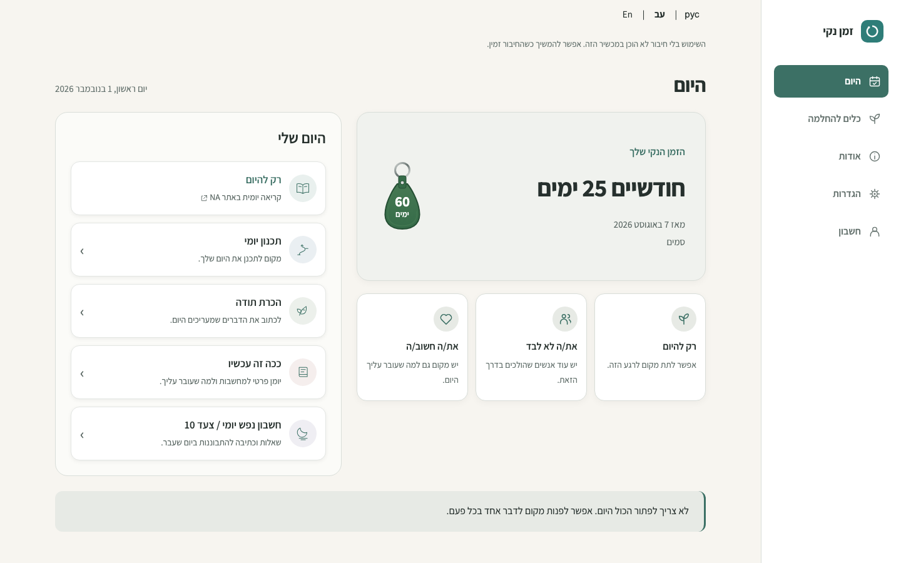

# PR #81 — desktop Home UAT revision

**Historical revision. The [current column-balance refinement and fresh Preview](PR-81-HOME-BALANCE-UAT.md) supersede this desktop composition.**

[Draft PR #81](https://github.com/onahum2023/clean-time/pull/81) ·
[Updated protected Preview](https://clean-time-rdlptlvvg-nu-cielo.vercel.app/) ·
[Integrated screen-by-screen UAT](ISSUE-80-INTEGRATED-UAT.md)

**HOLD for owner visual review.** This revision implements both owner comments:
[desktop hierarchy](https://github.com/onahum2023/clean-time/pull/81#issuecomment-6562122737)
and [static supporting cards/reflection](https://github.com/onahum2023/clean-time/pull/81#issuecomment-6562548447).
It supersedes the initial requirement to preserve desktop Home pixel-for-pixel.
Mobile Home, Welcome and the accepted desktop navigation rail remain the foundation.
No merge, Production deployment, Nora review or new backend integration.

## What changed

- Desktop Today has an intentional page heading and localized weekday/date. It
  replaces the generic app heading only while desktop Home is visible.
- A calm theme-aware counter surface groups natural calendar duration, the
  existing milestone keytag, start date and recovery identity. Month-end/leap-day
  anniversaries clamp using the existing calendar utility; optional start times
  are respected. Mobile retains its existing numeric summary. Existing numerical
  display modes remain in counter/details, as before.
- Five daily actions retain their exact order, labels and destinations. Desktop
  rows have concise functional descriptions, larger consistent icon circles,
  directional cues and explicit hover/keyboard focus/pressed treatment. There
  are no task-completion markers or extra recovery workflows.
- Three small static cards sit directly below the counter. At 1024px they become
  compact horizontal rows within the same counter column; at wider desktop sizes
  they sit side-by-side. A separate original, non-attributed reflection spans
  both columns. Counter/supporting cards and actions do not force equal heights.
- These four blocks are **static visual placeholders**. Copy is original and
  translated into Hebrew, English and Russian. They contain no controls, personal
  state, official NA quotations, links, scheduling, storage, feeds or requests.
  Dynamic/personalized content is deferred to a future feature after visual UAT.
- Below 1024px the new desktop heading, prose, cards and reflection are absent.
  The approved 2×2 action grid plus full-width Step 10 and fixed five-destination
  bottom navigation are preserved. Desktop keeps the mirrored RTL/LTR rail.

## Actual deployed screenshots

All Clean Time images below were captured from the protected Preview at application
commit `3983b8658d0831415520c3c7b4b51a39c78a1167`, version `2026.11.01.13`.
These are actual browser-rendered 1440×900, 1024×768 and 390×844 viewports,
not resized mockups. The `-full` images are separate full-page captures so the
reflection below the fold at 1024×768 is also reviewable.

Synthetic primary date: 7 August 2026; fixed clock: 1 November 2026, 13:00
Europe/Amsterdam. Fonts are loaded before capture. No document, static-asset or
backend response is mocked. Origin-scoped Preview access credentials stay in
memory. Service workers are blocked for deterministic screenshots, so the
existing offline-preparation notice is visible; real offline behavior is checked
separately. This notice is not new content in the redesign.

| Palette / width | Light viewport | Dark viewport | Light full page | Dark full page |
| --- | --- | --- | --- | --- |
| Original / 1440 | [View](pr-81-home-visuals/home-original-1440-light.png) | [View](pr-81-home-visuals/home-original-1440-dark.png) | [View](pr-81-home-visuals/home-original-1440-light-full.png) | [View](pr-81-home-visuals/home-original-1440-dark-full.png) |
| Forest / 1440 | [View](pr-81-home-visuals/home-forest-1440-light.png) | [View](pr-81-home-visuals/home-forest-1440-dark.png) | [View](pr-81-home-visuals/home-forest-1440-light-full.png) | [View](pr-81-home-visuals/home-forest-1440-dark-full.png) |
| Original / 1024 | [View](pr-81-home-visuals/home-original-1024-light.png) | [View](pr-81-home-visuals/home-original-1024-dark.png) | [View](pr-81-home-visuals/home-original-1024-light-full.png) | [View](pr-81-home-visuals/home-original-1024-dark-full.png) |
| Forest / 1024 | [View](pr-81-home-visuals/home-forest-1024-light.png) | [View](pr-81-home-visuals/home-forest-1024-dark.png) | [View](pr-81-home-visuals/home-forest-1024-light-full.png) | [View](pr-81-home-visuals/home-forest-1024-dark-full.png) |
| Original / 390 | [View](pr-81-home-visuals/home-original-390-light.png) | [View](pr-81-home-visuals/home-original-390-dark.png) | — | — |
| Forest / 390 | [View](pr-81-home-visuals/home-forest-390-light.png) | [View](pr-81-home-visuals/home-forest-390-dark.png) | — | — |

The optional second-counter examples use the exact prior handoff fixture, with
primary 1 January 2025 and secondary 1 May 2026:
[1440 light](pr-81-home-visuals/home-1440-light.png),
[1440 dark](pr-81-home-visuals/home-1440-dark.png),
[390 light](pr-81-home-visuals/home-390-light.png),
[390 dark](pr-81-home-visuals/home-390-dark.png).

## Comparison with the Lovable reference

The [Lovable Today reference](https://clear-days-companion.lovable.app/) was opened
through its guest setup with the same synthetic primary date. The reference image
is its actual 1440×900 light viewport captured on 1 November 2026. It is an external
visual reference, not Clean Time production or another implementation in this PR.

| Lovable reference | Revised Clean Time protected Preview |
| --- | --- |
|  |  |

The reference informs the page-level Today/date hierarchy, prominent duration and
keytag, counter/supporting-card column, roomier daily rows and full-width closing
strip. Clean Time keeps its own original copy, existing link destinations, five
navigation destinations including Account, available themes and preference/data
boundaries. It uses compact supporting cards rather than stretching them to the
height of the action list. The existing guest/registered behavior is preserved.

## Regression evidence

| Boundary | Result |
| --- | --- |
| Complete local regression coverage | **5,124 passing assertions across all 41 suites**, using the full sweep plus focused reruns described below |
| Final color-patch focused checks | **401 assertions pass**: Home revision (124), milestone/calendar/overlap (56), guided Home/preferences (193), desktop composition (28) |
| Final color-patch wider regressions | **1,398 assertions pass**: all-screen enlarged text/themes (762), RTL/LTR navigation (556), offline upgrade (21), preference/registered-data upgrade (59) |
| Final actual protected Preview | **1,980 UI assertions pass**: Home revision (124), desktop composition (28), guided Home (193), enlarged text/themes (762), navigation (556), Welcome (306), setup (11) |
| Final deployed guest workflows | **106 checks pass** at 1440px/390px: Journal reload, Step 10 save/print/PDF, palettes/preferences, exact recovery bytes and guest-only backend configuration |
| Actual Home contrast | **10,368 text/surface combinations pass** at rest and with a real daily-row hover, across all palettes/backgrounds/device accents and light/dark |
| Preservation images | **10 actual deployed images byte-identical** to the prior handoff: mobile Home light/dark plus Welcome light/dark desktop/mobile viewport/full-page captures |
| Preference contracts/build guards | **10 Node tests pass**, including 3,240 startup compatibility combinations; exact CSP hashes, Preview build, repository hygiene and whitespace checks pass |

The full sweep passed 5,067 assertions and caught one obsolete badge-size
expectation. The expected geometry was updated to the intentional 80×112 desktop
and 64×90 threshold keytag; every overlap/bounds check remains, with added explicit
1024px/1440px coverage. Its complete 56-assertion suite passes. The final hover
contrast check adds one assertion, and the final desktop color correction was
retested with the focused and wider groups above. The aggregate latest passing
coverage is 5,124 assertions; there are no outstanding failed checks. These are
multi-run results, not a claim that the first full sweep had zero failures.
The new deployed locale assertion also raced the document replacement during a
language reload once. It now waits explicitly for DOMContentLoaded, then all 124
Home checks pass. No application language behavior was changed; the deployed
coverage total combines the full UI group with this focused rerun.

Actual normal/hover checks found slightly low contrast in small counter metadata
and daily-row descriptions/cues. The desktop-only text colors were corrected,
then all 10,368 combinations passed. Mobile styling remains unchanged.

The new Home checks also cover localized two-month/25-day phrasing, clamped
month-end/leap anniversaries, optional start time, secondary/keytag visibility
preferences, exact recovery-byte preservation, original labels/order/destinations,
static blocks without controls and keyboard traversal/navigation. The existing
full sweep covers auth, encryption, sync, history, writing, export and print/PDF
with synthetic records; it is not a live-backend acceptance result.

Reproduce the new captures with `tests/home-visual-revision-capture.js` and the
matched preservation captures with `tests/integrated-visual-capture.js`, setting
`QA_BASE_URL` to the exact Preview and `QA_CAPTURE_OUTPUT` to a local destination.
Protected access uses the existing origin-scoped in-memory helper. Raw logs stay
in ignored `qa-artifacts/`; no auth headers, recovery exports or session state are
published.

## Owner review

- [ ] Review the whole 1440px and 1024px composition in light/dark Original/Forest.
- [ ] Confirm counter/keytag/date grouping and relative weight against the actions.
- [ ] Confirm the static copy, three small cards and reflection treatment.
- [ ] Confirm the approved mobile grid/footer and existing counter preferences.
- [ ] Review English/Russian wording and native zoom/keyboard on target devices.

The Preview remains guest-only under its existing build configuration. Auth,
encryption and sync regression checks use synthetic local SDK mocks; live email,
registered/two-device backup acceptance and additional backend integration stay
deferred. Automated text enlargement and responsive reflow do not establish
native browser zoom or physical mobile/screen-reader acceptance.
