# PR #72 — Hebrew RTL visual comparison

All data shown is synthetic. Before: main after PR #71 (`bcb72c4`). After: the application at `7c4f096`, including the restored bottom navigation. These images were captured in a local Chromium browser; they are **not evidence of deployed Preview interaction**. The final deployed smoke test is separately documented in [the QA report](../RESPONSIVE-UX.md).

Desktop: 1440px wide. Mobile: 390px wide. Light theme. Full-page captures can show the fixed bottom bar at the original viewport edge within a taller image. Open each image to inspect its original resolution.

## What changed

- Home uses a wider content area while preserving the five daily actions and their order.
- Settings places recovery/account controls and appearance/export controls in two desktop columns.
- Journal and Step 10 have wider, bounded writing areas; Step 10 keeps a single sequence of questions.
- At 390px, the initial Home and Step 10 screenshots intentionally match the baseline; the working mobile layout is preserved. Bottom navigation stays fixed at all widths, with the original order and active-page highlighting in a centered 520px container.

## Comparisons

### Home — desktop

| Before | After |
| --- | --- |
| 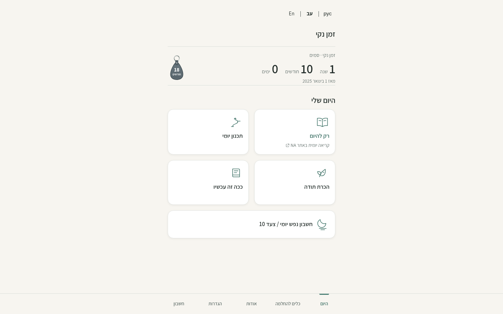 | 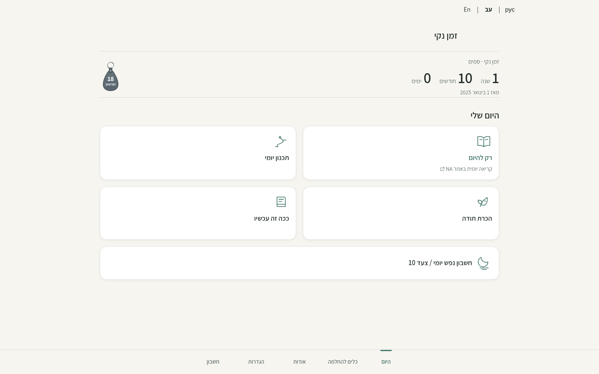 |

[Open before at full size](desktop-home-before.png) · [Open after at full size](desktop-home-after.png)

### Settings — desktop

| Before | After |
| --- | --- |
| 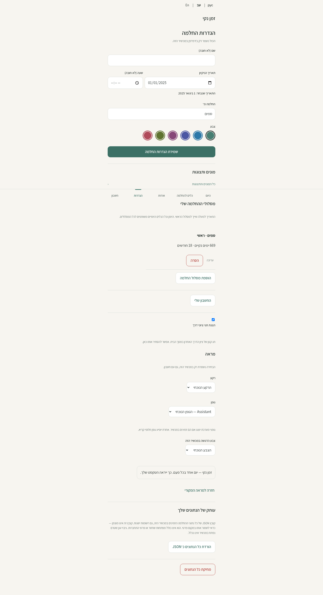 | 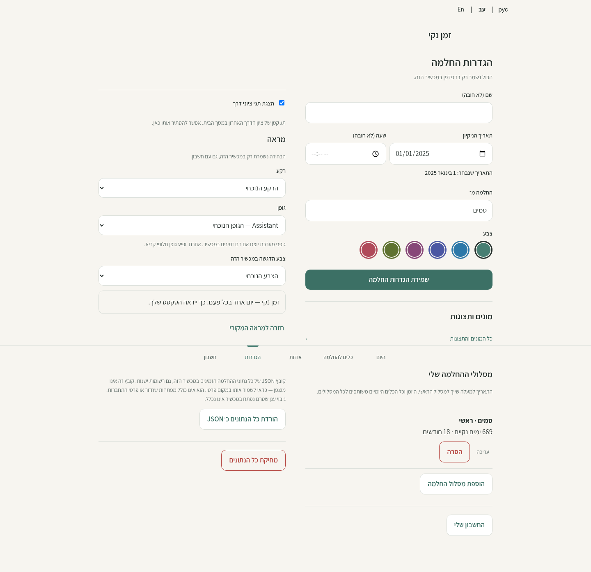 |

[Open before at full size](desktop-settings-before.png) · [Open after at full size](desktop-settings-after.png)

### Journal writing area — desktop

| Before | After |
| --- | --- |
| 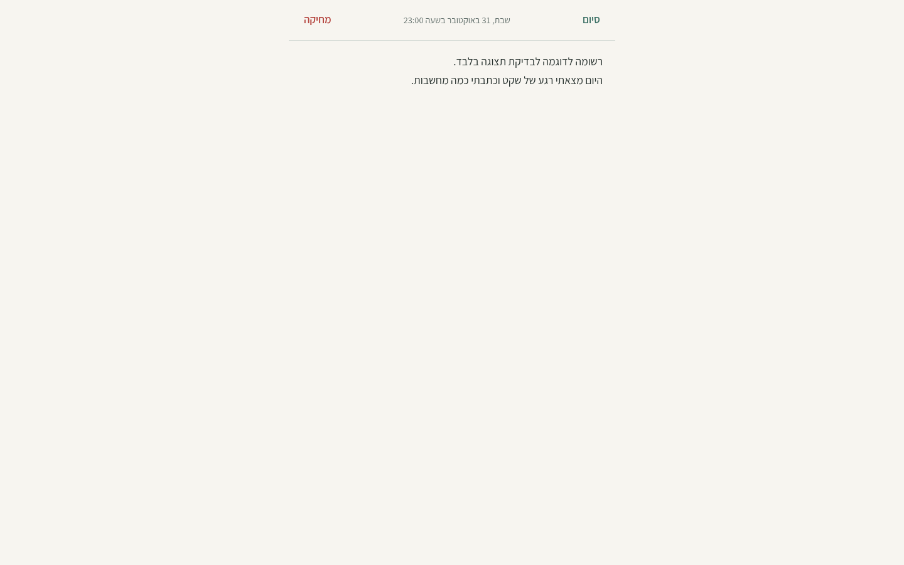 | 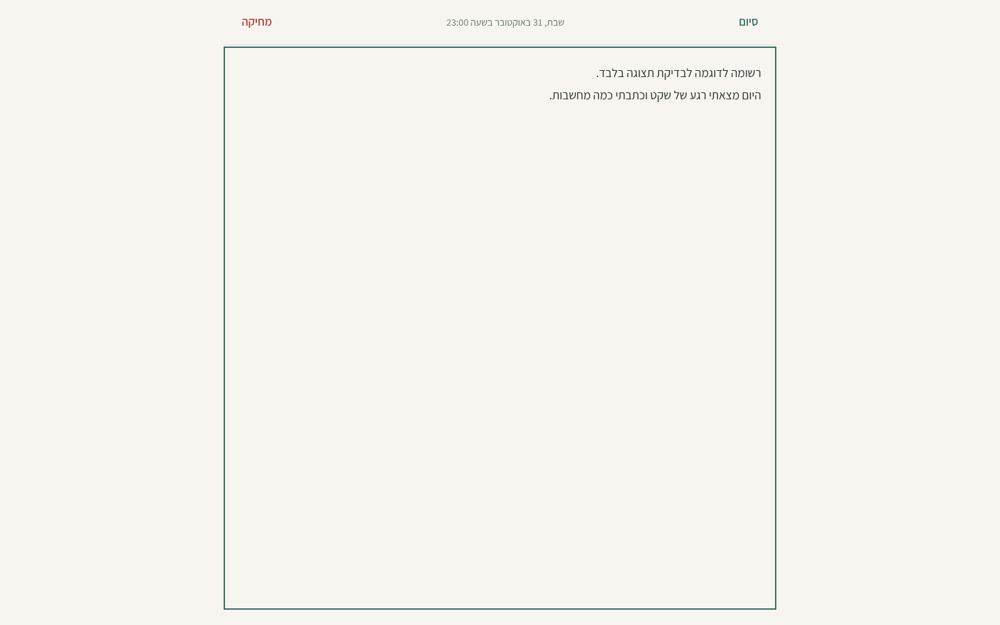 |

[Open before at full size](desktop-journal-before.png) · [Open after at full size](desktop-journal-after.png)

### Journal list — desktop

| Before | After |
| --- | --- |
| 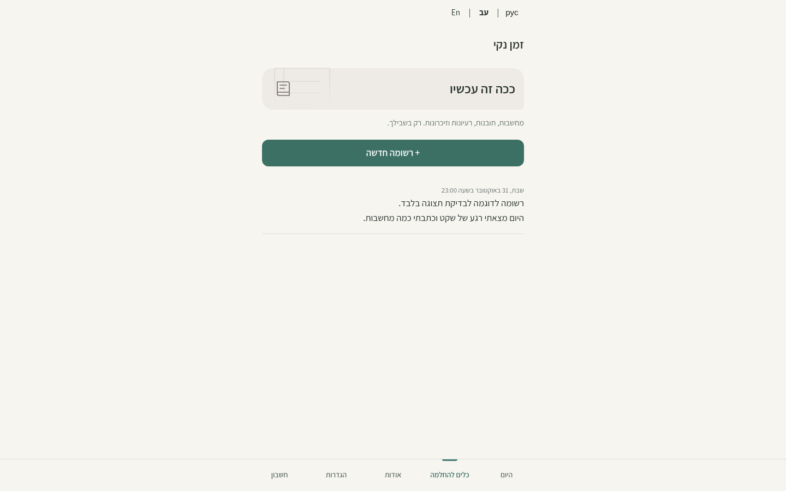 | 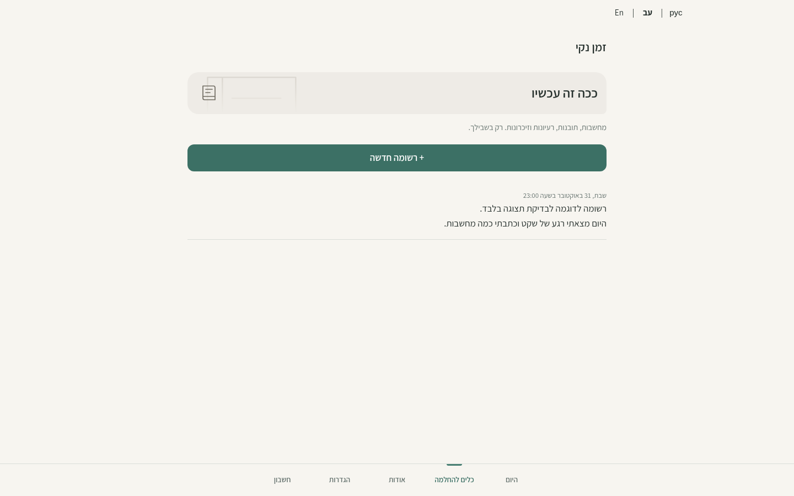 |

[Open before at full size](desktop-journal-list-before.png) · [Open after at full size](desktop-journal-list-after.png)

### Step 10 — desktop

| Before | After |
| --- | --- |
| 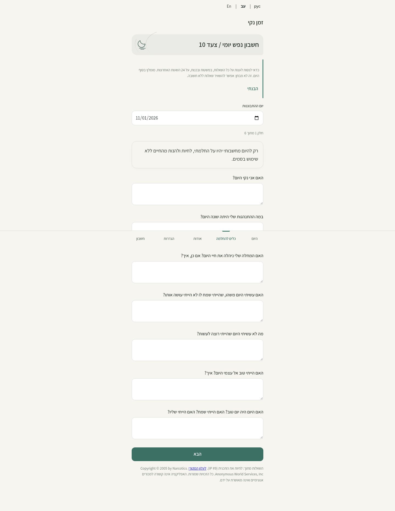 | 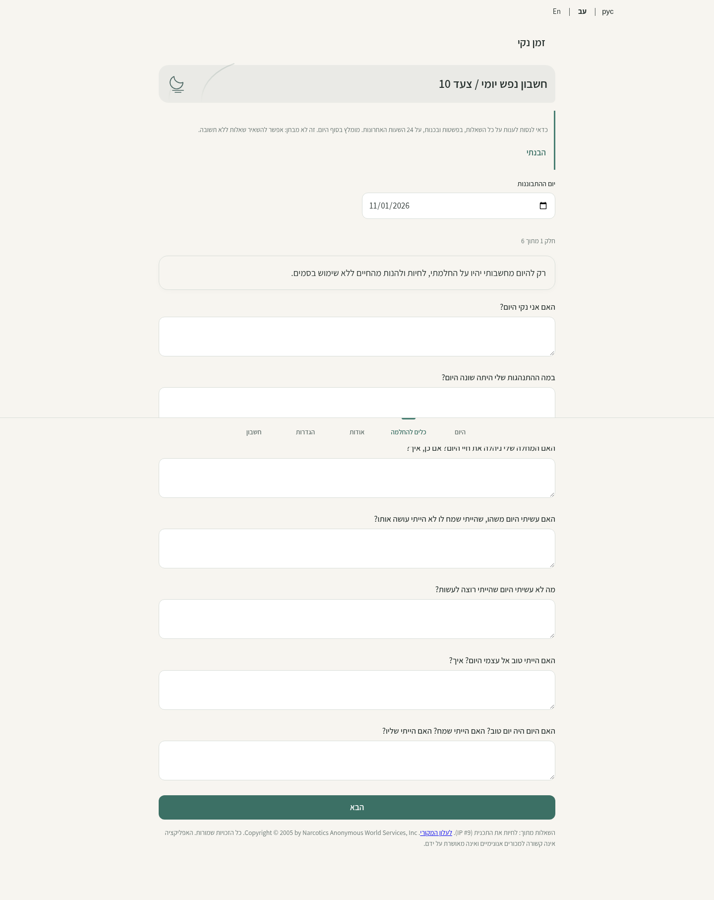 |

[Open before at full size](desktop-step10-before.png) · [Open after at full size](desktop-step10-after.png)

### Home — mobile

| Before | After |
| --- | --- |
|  | 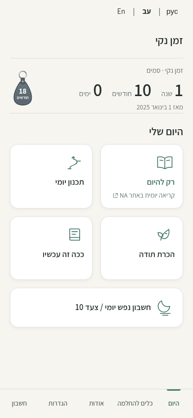 |

[Open before at full size](mobile-home-before.png) · [Open after at full size](mobile-home-after.png)

### Step 10 — mobile

| Before | After |
| --- | --- |
| 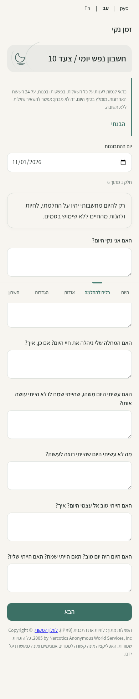 |  |

[Open before at full size](mobile-step10-before.png) · [Open after at full size](mobile-step10-after.png)
