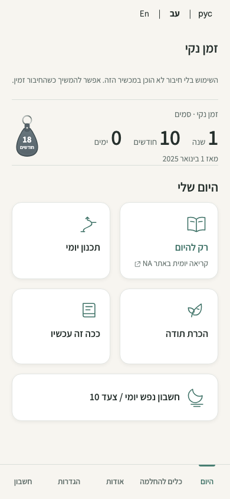
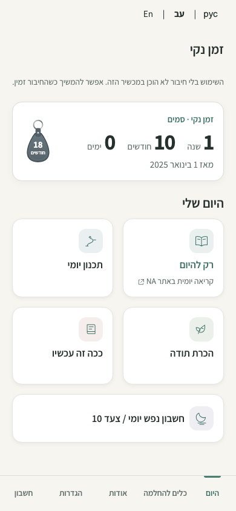
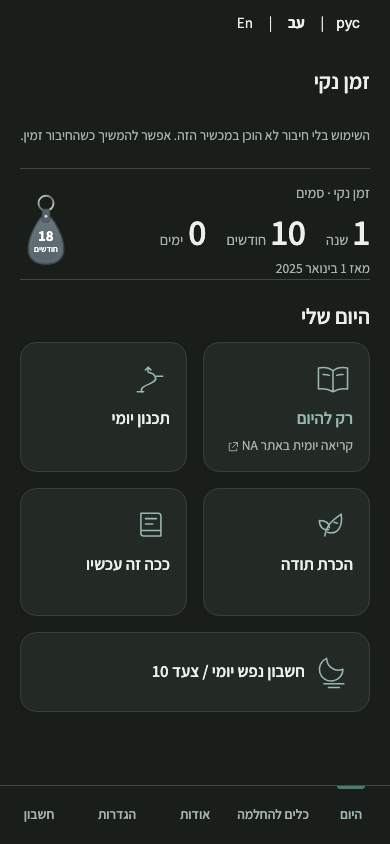
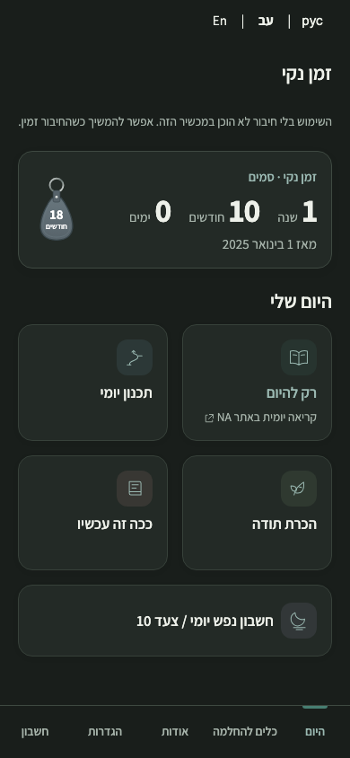
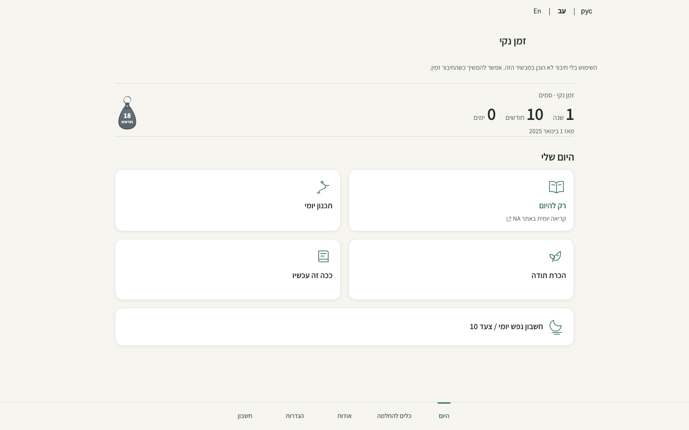
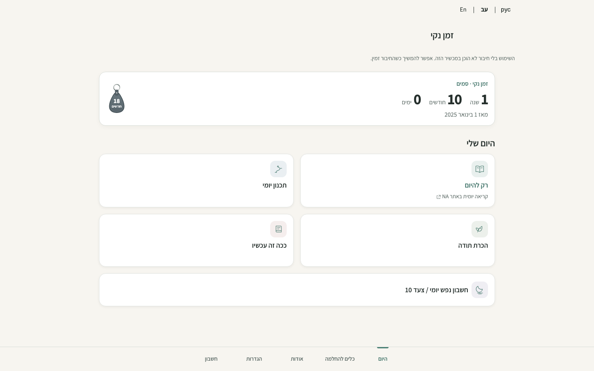
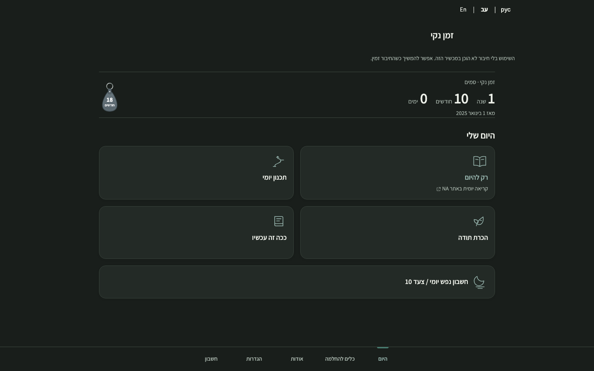
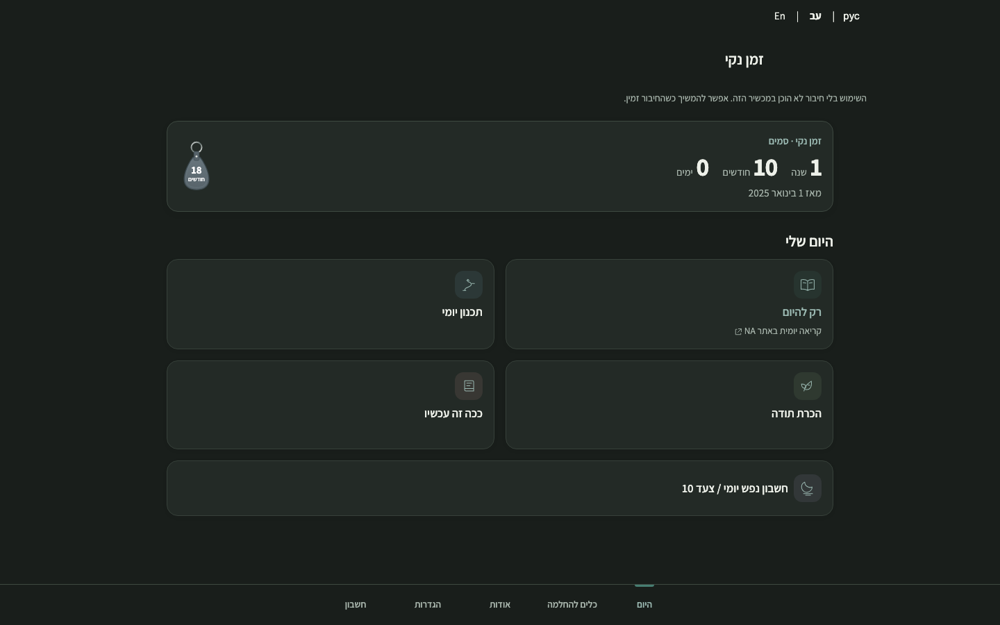

# Issue #73: first visual polish

The existing responsive layout and 2×2 plus full-width daily action order remain. The compact counter now has a quiet surface and stronger numeric/date hierarchy; action illustrations have restrained tinted backgrounds. External recovery links and telephone actions show different indicators. Guest setup previews the selected valid start date as a localized day count without saving data. Settings headings receive a small typographic refinement. Existing appearance choices and the fixed bottom navigation remain in place.

These local Chromium captures show synthetic guest data, Hebrew RTL and matching viewports and color schemes. They compare merged main (`9f4148b`) with this branch. Service workers and external requests were blocked for isolation; the visible offline-preparation notice reflects that capture setup. They are not deployed Preview or registered-account evidence.

| View | Before | After |
| --- | --- | --- |
| 390px light |  |  |
| 390px dark |  |  |
| 1440px light |  |  |
| 1440px dark |  |  |

Local synthetic browser validation: 1,520 assertions passed across Home, Welcome, responsive layouts, navigation, appearance, account, encryption, sync and recovery-flow suites; the language suite separately passed 64 assertions and the focused setup/resource suite passed 11. The initial language invocation used its default port 8767 and could not connect; it passed when rerun on the active 8765 server. Account and encrypted sync coverage uses synthetic identities and mocked services, not live registered-account UAT. At 320px, the default accent text measured 5.68:1 in light and 6.90:1 in dark against the card surfaces, keyboard focus was visible, and reduced-motion mode rendered without overflow. This is a targeted check, not a complete accessibility audit.
